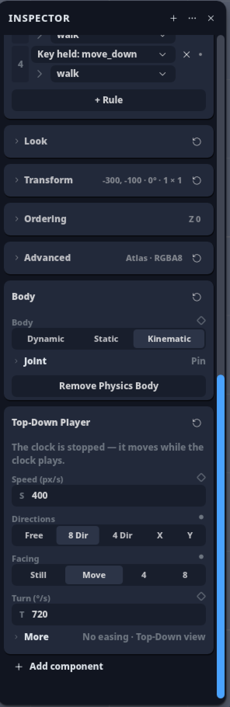
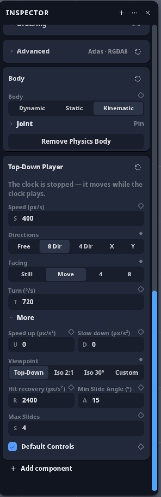
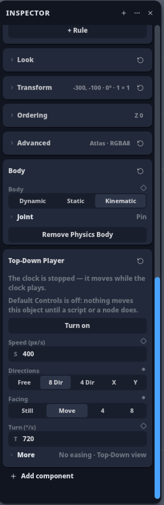
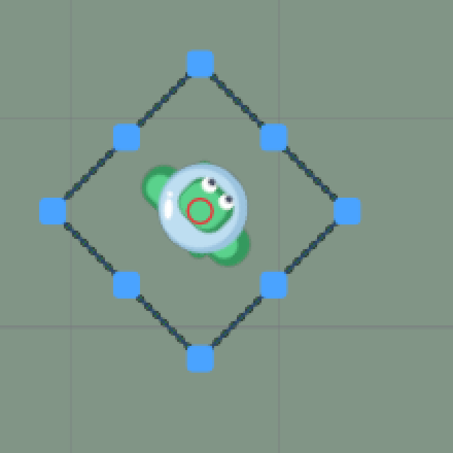
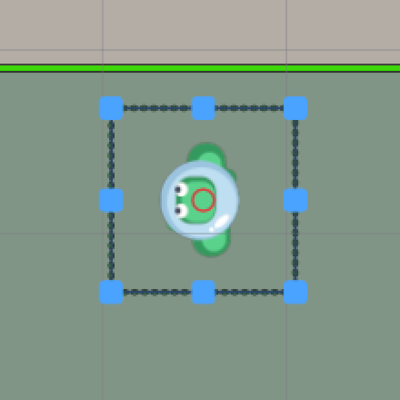
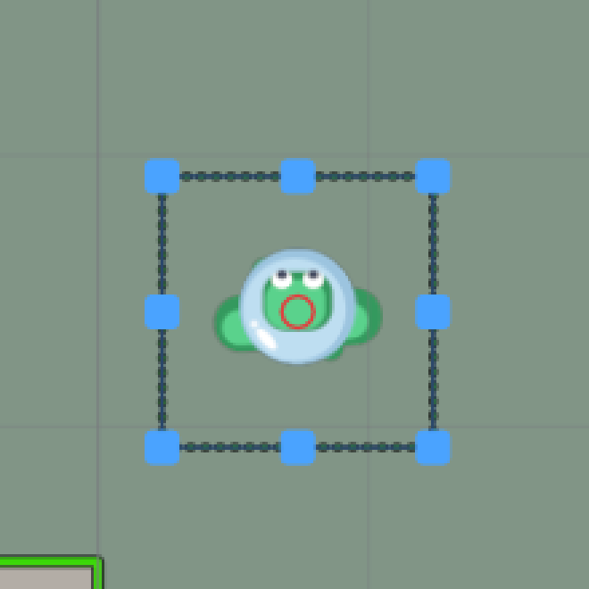

# Top-Down Player

**Estado: `fechado`** (12/11). Versão A escolhida pelo dono; smoke do dono OK em 12/11. Handoff: [`HANDOFF_INTEGRACAO_line_GameEngineFuncional_2026-11-12_TOPDOWN.md`](../handoffs/HANDOFF_INTEGRACAO_line_GameEngineFuncional_2026-11-12_TOPDOWN.md).

Estudos lidos:
- crítica `critica_ph2d.html#topdown`, §1–§7, com o «Vale rever?» do Facing.
- O estudo não tem seção própria; a crítica usou só a doc das engines, sem foto.

Base: `main` `4f46a3573c`.

## Como está (conferido no código)

- **A lei** é `TopDownLaw`, em `crates/ph2d-topdown/src/lib.rs:75-139`.
  - Tem 12 campos e todos têm leitor na ponte (`bridge/topdown.rs`, `drive_topdown`). Nenhum controlo está morto.

  | # cat. | Campo | Padrão | Leitor |
  |---|---|---|---|
  | 0 | Speed | 4 m/s (= 400 px/s a 100 px/m) | ponte |
  | 1–2 | Acceleration, Deceleration | 0 = instantâneo (`intent.rs` `aproximar`) | ponte |
  | 3 | Directions | Free · **8** · 4 · só X · só Y (`direction.rs:124-140`) | ponte |
  | 4–5 | Viewpoint, Board Angle | Top-Down · Iso 2:1 · Iso 30 · Custom; o ângulo só vale em Custom (`viewpoint.rs:75`) | ponte |
  | 6–7 | Facing, Turn Speed | None · Move · Snap 90 · Snap 45; 720°/s, só se gira (`rotation.rs`) | `set_next_kinematic_pose` |
  | 8–9 | Min Slide Angle, Max Slides | 15° · 4 (`slide.rs:17,57-94`) | laço de deslize |
  | 10 | Default Controls | ligado (`keyboard_driven.rs`) | quem recebe o teclado |
  | 11 | Push Recovery | 24 m/s²: o empurrão de um golpe decai até 0 (`lib.rs:102-112,188-192`) | `intent::recover` |

- **O painel** é uma lista de linhas, não cartões: `ph2d-panel-inspector/src/sections/topdown.rs` (458 LOC), `event_topdown.rs` (96), `sync_topdown.rs` (71) e `populate_topdown.rs` (89).
  - Ordem: avisos · Speed · Acceleration · Deceleration · Push Recovery · Directions · Viewpoint · Board Angle (só em Custom) · Facing · Turn Speed (só se gira) · Min Slide · Max Slides · Default Controls.
  - O aviso de Default Controls desligado já existe (`fn deslize`), mas não tem botão de saída.
- **Ao adicionar**, o corpo nasce Kinematic (`physics_seed.rs:44-56,151-152`).
- **Não há cena de smoke nem foto** com um Top-Down. A próxima cena é `PH2D_GAME_SMOKE=24` (`smoke.rs:23`).
- **Para conferir antes da obra:**
  - Se a imagem gira de facto com a pose do corpo. A crítica também não confirmou; a cena 24 mostra.
  - O `label()` órfão de `Viewpoint` (`viewpoint.rs:55-60`).

### Da crítica, o que não vale

- «15 campos, com 2 condicionais» são **12 campos**, com Board Angle e Turn Speed condicionais.
- «Push Recovery: não confirmei» foi confirmado: o leitor decide (`intent::recover`).

## O que as 9 engines fazem (crítica §2, só doc)

- Comportamento pronto só existe no Construct (8 Direction) e no GDevelop (Top-down movement). Nas outras engines é código sobre o corpo.
- Os 10 campos do GDevelop dizem o mesmo que os nossos 12. Ele não tem Push Recovery nem os dois de deslize.

## Cortar e acrescentar (crítica §3–§4)

- **Juntar:**
  - Acceleration e Deceleration viram «Speed up» e «Slow down». O rótulo passa a dizer que «0» é instantâneo.
- **Para More, fechado:**
  - Viewpoint e Board Angle, com a dica: «muda para onde a tecla Up leva».
  - Push Recovery, com rótulo que se explica.
  - Min Slide e Max Slides.
  - Default Controls.
- **Acrescentar:**
  - Botão «Turn on» no aviso de Default Controls desligado.
- **Fica de fora:** a rosa dos ventos (versão C).
  - Custa 5 cliques contra 2.
  - Teria de recusar combinações que o motor não tem.

## As três versões ([maquetes da crítica](file:///home/enio/Documentos/GameEngineSamples/critica_ph2d.html#topdown))

| | Hoje | A · três perguntas | B · Move, Picture, View | C · rosa |
|---|---|---|---|---|
| Campos à vista | 12, em lista | **6** | 8 | 6 |
| Cliques para 4 direções + imagem gira | 2 | 2 | 2 | 5 |
| Accel/Decel | à vista | More | à vista | etiqueta |
| Viewpoint | à vista | More | cartão dobrado | etiqueta |

- **A:** Speed, Directions e Facing à vista. Abaixo, «More · No easing · Top-Down view». Recomendação da crítica.
- **B:** três cartões, no molde do Character.
  - Move: Speed, Speed up, Slow down, Directions.
  - Picture: Facing, mais Turn quando gira.
  - View: Viewpoint, mais Board Angle em Custom.
- **Facing com nomes curtos:** Still · Move · 4 · 8, com o nome inteiro no hover. Os nomes de hoje não cabem em 290 px; a regra do «…» só vale para rótulo.

## Recomendação

**A**, nos cartões da casa (a dobra More é a mesma do Character).
- O componente é pequeno e os padrões já andam ao Play.
- A regra «0 = instantâneo» fica legível no More («No easing»).
- O More usa os rótulos simples da B: Speed up, Slow down, View.

## Provas da obra (quando aprovada)

- Teste de clique real em cada controle novo, e de animação (abrir e fechar) na dobra More.
- O cartão escreve no componente e a ponte lê. Um gate por campo, com a mutação vista a vermelho.
- Cena `PH2D_GAME_SMOKE=24`: um herói de vista de cima, selecionado, que anda ao Play, com fotos.

## O que foi construído

Versão A, nos cartões da casa. Commits e provas no [handoff](../handoffs/HANDOFF_INTEGRACAO_line_GameEngineFuncional_2026-11-12_TOPDOWN.md).

- **Cartão:** Speed, Directions e Facing à vista; dobra More fechada com resumo («No easing · Top-Down view»); botão «Turn on» no aviso «Default Controls is off: nothing moves this object until a script or a node does.». Rótulos novos: Speed up, Slow down, Turn, Hit recovery (os nomes de script não mudaram).
- **Cena `PH2D_GAME_SMOKE=24`:** o herói visto de cima (folha de fábrica `boneco_de_cima.svg`, 6×2, idle 4 · walk 6), montado por peças, selecionado, anda ao Play; a imagem gira com o corpo (gate a 45/90/0°).

| Cartão | More aberto |
|---|---|
|  |  |
| **Default Controls desligado** | **Play, diagonal** |
|  |  |
| **Play, só ←** | **Play, só ↑** |
|  |  |

O Play do smoke (`PH2D_GAME_SMOKE_DRIVE=editor`, `HORARIO_24`): ↗ até à parede de cima e desliza ao canto, só ←, só ↓ e só ↑ de volta à parede, livre em cada trecho (gate `o_horario_do_play_anda_so_para_cima_e_so_para_a_esquerda`). Fotos inteiras: [↗](fotos_05/24_play_diagonal.png) · [←](fotos_05/24_play_esquerda.png) · [↑](fotos_05/24_play_cima.png) · [↑ junto à parede](fotos_05/24_play_cima_02.png). Os recortes são do app, ampliados 3×.
