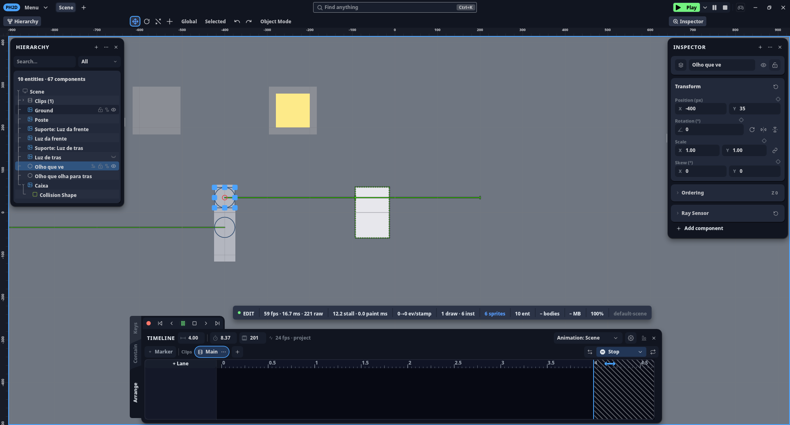

# Ray Sensor

**Estado: `em estudo`** (15/11) — versões A/B/C mostradas ao dono; aguarda a escolha. Nada construído.

Estudos lidos:
- crítica `critica_ph2d.html#raysensor`, §1–§7, com o «Vale rever?» da Origin na C.
- O estudo não tem seção própria; a crítica usou só a doc das engines, sem foto.

Base: `main` `7b3dd983f7` (linha no mesmo sha).

## Como está (conferido no código)

- **O componente** `RaySensor` (`ph2d-physics-ecs/src/components/ray_sensor.rs`): `origin` (m, local), `dir`, `reach` (m), `layer: u8`.
  Padrão `origin 0,0 · dir 0,-1 · reach 1 · layer 0`. **`dir 0,-1` olha para BAIXO** (Y do mundo cresce para cima:
  `ph2d-physics/src/world.rs:310`, `ph2d-render/src/camera.rs:283`). A tela não o diz — confirma a queixa da crítica.
- **O lance** `cast_ray_sensors` (`ph2d-physics-ecs/src/bridge/ray_sensors.rs:143`) via `PhysicsWorld::cast_ray`
  (`world/cast.rs:107`): exclui o próprio corpo, não vê sensores/triggers. Grava `ray_enters`/`ray_exits`, que
  `signal_events` (`bridge/signals.rs:102`) torna sinais On Enter / On Exit.
- **No canvas** o raio JÁ se desenha no editor (foto abaixo): `probe_marks` (`ph2d-app-physics/src/overlay/probes.rs:66`),
  três estados (Idle 0,45 · Clear 0,72 · Hit 1,0 de alfa, tique no acerto). **Não há alça**: pegar na ponta não existe.
  O único gizmo de ponto é o das âncoras de junta (`overlay/point_gizmo.rs`) — molde para a alça.
- **O cartão** (`ph2d-panel-inspector/src/sections/ray.rs`, `corpo`): avisos · leitura viva «sees X at Y» ·
  relógio parado · Origin X·Y · Direction X·Y · Reach · Layer · On Enter · On Exit (texto). 8 valores, todos com
  leitor que decide (`ray_inspector.rs`, `ray_edits.rs`, `signals.rs`). Nenhum controlo morto.
- **Layer** é um índice `u8`, mas **já tem nomes**: o cartão usa `camada_por_nome::linha_da_camada` (`DO_RAIO`,
  `ids/inspector_ray.rs` `INSP_RAY_LAYER_OPTS`) sobre `LayerNames` (`ph2d-physics-ecs/src/layer_names.rs`).
- **Um sensor por objeto**: `RaySensor` é componente único por entidade. Dois raios = dois objetos (filhos).
- **Quem ouve o sinal**: a contagem existe (`ph2d-signal-census/src/lib.rs:224`, `listeners`) e o Timeline já a mostra
  (`ph2d-panel-timeline/src/signal_ouvintes.rs:436`). O cartão do Ray não a usa.
- **Smoke de hoje** `PH2D_RAY_SMOKE=1` (`ph2d-app-components/src/ray_smoke.rs`): dois olhos (frente/trás), caixa, duas
  luzes. Próxima cena do Game Engine: `PH2D_GAME_SMOKE=26`.

### Da crítica, o que não vale

- «Layer (inteiro)… se errar, nada acontece»: **Layer já escolhe por nome** hoje. O que falta é o aviso
  «nenhum objeto nesta camada» (B·3).
- «Pegar nele com o mouse: supus que não dá»: **confirmado, não dá**.
- «Não vi se um objeto aceita dois sensores»: **não aceita**. Isto pesa contra tirar Origin (C): o 2.º raio vive
  num filho, e a origem passa a ser a posição do filho — sem perda de poder.
- «Aviso de sinal solto só se o app listar quem escuta»: **lista**, a função já existe.

## O que as 9 engines fazem (crítica §2, só doc)

- Quase tudo é função de código (Unity, Unreal, GameMaker, Roblox, UEFN, Cocos). Peça pronta: Godot (RayCast2D,
  `target_position` = um vetor, com alça no editor) e Construct (Line-of-sight).
- Nenhuma mostra a leitura «vê X a Y» sem código. É o melhor do nosso.

## As três versões ([maquetes da crítica](file:///home/enio/Documentos/GameEngineSamples/critica_ph2d.html#raysensor))

| | Hoje | A · Looks em palavras | B · Angle + cartão Signals | C · alça na ponta |
|---|---|---|---|---|
| Campos à vista | 8 valores, em lista | 6 + More | 10 | 7 |
| Gestos: olhar à direita, 2 m | 4 | 2 | 2 | 1 (arrastar) |
| Direção | X·Y | Down·Up·Left·Right (ângulo em More) | Angle (graus) | alça / «90° · 100 px» |
| Origin | à vista | More | à vista | sai (objeto/filho) |
| Sinais | à vista | On Exit em More | cartão Signals | à vista |

## Recomendação

**B, com a alça da C no canvas** (como a crítica), nos cartões da casa:
- Angle (graus) no lugar de Direction X·Y; o motor continua com o vetor (`dir = (cos, sin)`), sem subir schema.
- Layer com nomes (já existe) + aviso novo «Nothing in this layer…».
- Cartão «Signals» com On Enter/On Exit e o aviso «This signal is not used by anything yet» (via `listeners`).
- Leitura «Sees X at Y» à vista.
- Alça na ponta do raio no canvas: arrastar muda Angle e Reach num passo de undo (molde `point_gizmo.rs`).
- Cena nova `PH2D_GAME_SMOKE=26` com o olho selecionado e o cartão aberto.
