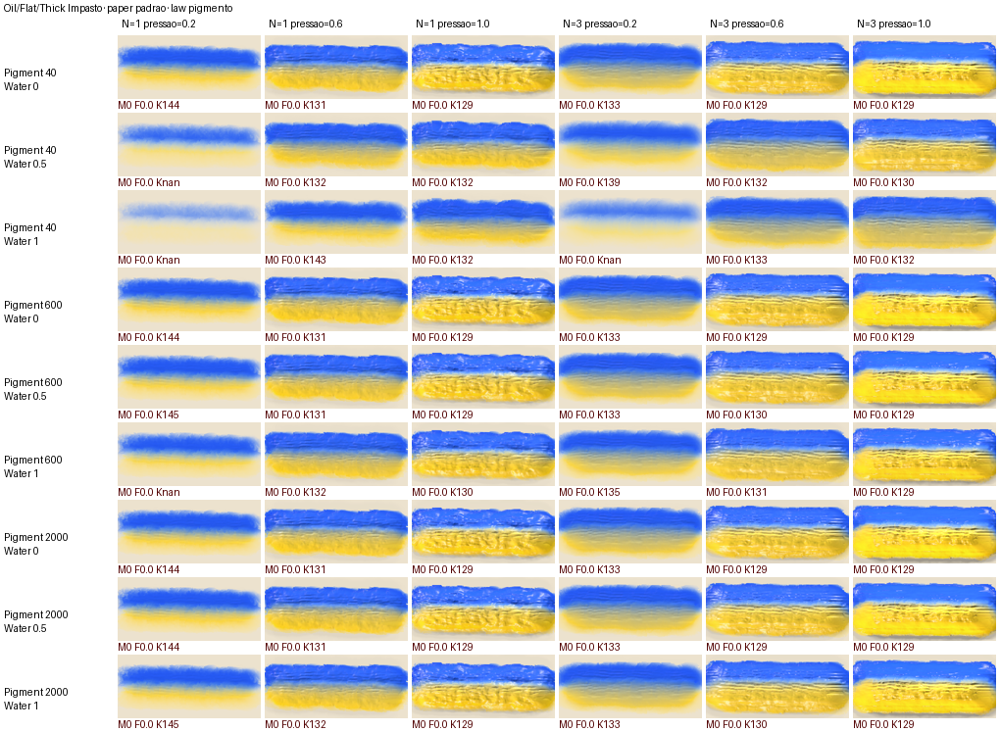
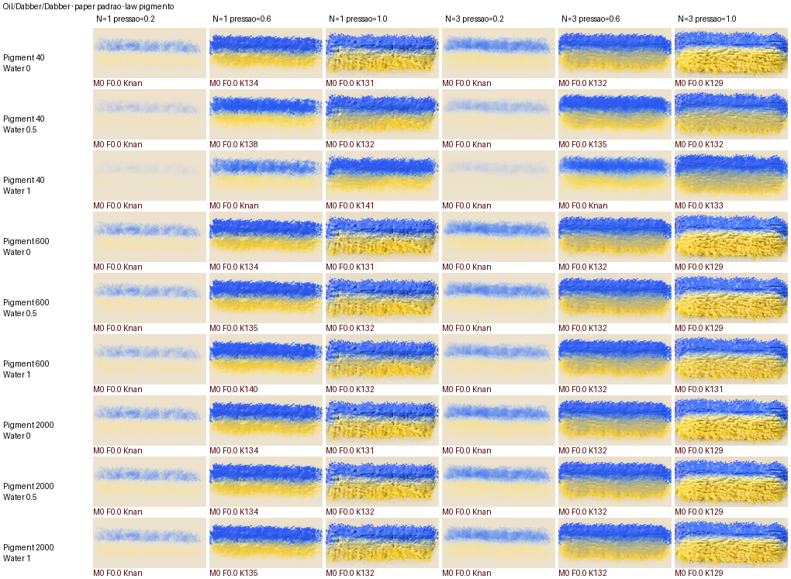
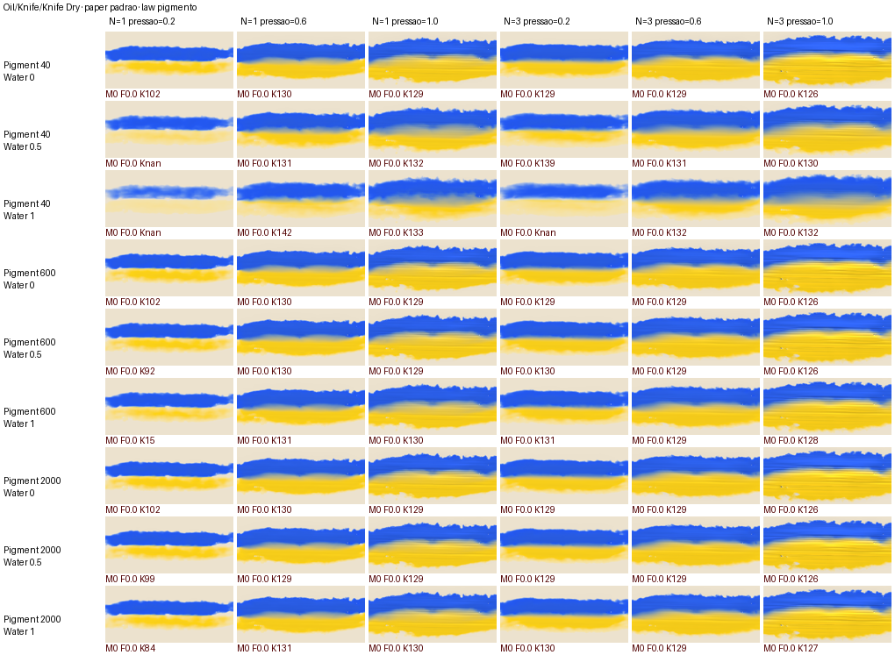

# E9 — o portão-mãe (a varredura F0 sobre o motor, nas duas leis × dois papéis)

> Leitor: a próxima LLM. Plano: [F4_2 §5 e §7 E9](F4_2_plano_wet_paint.md) · régua: [F0_varredura.md](F0_varredura.md)
> (§3.0 F0b, §4 limiares) · [ADR-0197](../../architecture/decisions/0197-o-painter-e-uma-lei-de-pigmento-em-volumes-e-os-meios-sao-pontos-dela.md) §4 item 1.
> ⛔ Dono 31/10: o portão-mãe corre sobre o **papel texturizado PADRÃO** do app; o padrão é o que decide.

## 1. O que mudou

- **Setter do produto** `PainterTool::set_wet_lei_da_tinta(LeiDaTinta)` + leitor `wet_lei_da_tinta()`
  (`crates/ph2d-tool-painter/src/tool/paint/wetpaint.rs`, ao lado de `set_wet_relogio_fixo`). Cria a sessão se
  falta (`ensure_wet_session`) e escreve `engine.sim.tinta`; sobrevive a `wet_preset_aplicar` (a sonda afirma-o
  a cada passada: `assert_eq!(t.wet_lei_da_tinta(), Some(cena.lei))`).
  - É `pub(crate)`: não há consumidor fora da crate (sem UI nesta etapa). Quando a app o usar, passa a `pub` e
    entra em `macro_track/portas_internas.rs` (o gate `toda_porta_do_painter_tem_decisao` varre `    pub fn`).
  - ⚠️ **Aberto:** uma sessão NOVA (undo que mata a sessão, guarda do canvas, troca de grid ratio) nasce `Velha`.
    O gancho é uma linha em `ensure_wet_session` (`wetpaint/authored_actions.rs`, fora dos paths da E9):
    guardar a lei em `WetPaintState` e `engine.sim.set_tinta(..)` ao nascer. Na sonda não acontece (o assert passa).
- **Eixo PAPEL** na sonda (`sonda_varredura_oleo.rs`, `enum Papel { Padrao, Liso }`): `PH2D_SONDA_PAPEIS=padrao,liso`
  (omissão: os dois). O **padrão** é o do *New Image… → Textured Paper* (`PAPEL_TEXTURIZADO` em
  `crates/ph2d-tool-painter/src/tool/papel_texturizado.rs`: Cold Press `#E6D9CC`, relief 0,5, roughness 0,5,
  tooth 1), aplicado pelo MESMO caminho do produto: a sprite nasce `pixeis_do_papel_texturizado(W, H)` e abre como
  documento por `abre_a_sprite_nova` (o que `bind_document_corpo` chama) — que reconhece a sprite nascida, abre o
  fundo vazio e serve o papel. `liso` = a tela transparente da F0. O laço do papel fica por fora do das leis (as leis
  continuam o mais interno). TSV: coluna nova `papel` (`padrao|liso`, a última); a antiga coluna `papel` (Depth do
  `PH2D_SONDA_PAPEL` da F0b) chama-se agora `papel_depth`. PNG: sufixo `_<lei>_<papel>`.
  - O papel não entra no `canvas_rgba` (compõe-se só na saída, `compoe_sobre_o_papel`): a régua continua a ler a
    camada sobre o creme `236,226,206`. O papel entra pela física (o dente/relevo do papel no depósito e no filme).
- **O veredicto** (`fotos/f0_varredura/resumo_f0.py`; a tabela antiga «pior por pincel» fica em `--pior`): por
  célula e por lei, os limiares finais da F0 §4 (F0b) nas colunas `*_plano` — `manchas_azul_plano ≤ 1 %`,
  `km_p99_plano ≤ 8`, `km_max_plano ≤ 20`, `ferrugem_plano ≤ 0,05 %`, `furos = 0` só se a mesma célula a pressão 1
  tem `furos < 1 %`, `degraus_y_plano ≤ N−1`, `degraus_x_plano ≤ 2`. Depois a tabela «Velha × Pigmento: passam /
  total, por papel» e a lista das células que reprovam na Pigmento com a(s) métrica(s). Célula com `km_p99_plano`
  NaN (nada com alfa ≥ 0,9) conta «sem medida», nunca «passa». Nenhuma coluna `*_plano` faltava (`furos_pct` lê o
  alfa, não depende da luz).
- **Mosaico** (`mosaico_f0.py`): um PNG por pincel × papel × lei (`<slug>_<papel>_<lei>.png`), legenda pelo plano.
- **`corre_f0.sh`**: exporta `PH2D_SONDA_LEI=velha,pigmento` e `PH2D_SONDA_PAPEIS=padrao,liso` por omissão;
  `PH2D_F0_TIMEOUT` (omissão 14400 s por grupo; o 1500 antigo cortava a grelha a 564/810).
- **Teste** `portao_mae_f0_lei_pigmento_minimo` (`wetpaint_preset/portao_mae_f0.rs`, filho da sonda; os limiares
  em `const`, os MESMOS do `resumo_f0.py`): Thick Impasto + Watercolor/Fluid/Wet Round, P600/W0,5/pr1/N3, papel
  padrão, as duas leis; afirma os limiares na Pigmento (e que a célula cobre: `km_p99_plano` finito).
  `#[ignore = "E9: liga quando a E6b/E8 fecharem"]` — hoje VERMELHO (abaixo).

## 2. A corrida de prova (1 célula × 2 leis × 2 papéis)

`Oil/Flat/Thick Impasto` P600/W0,5/pr1/N3, pausa 300 (o filtro `sonda_varredura_oleo` também apanha o teste
mínimo, que correu junto por `--ignored`; 38 s de parede, 7–13 s por célula, a Pigmento ~35 % mais lenta):

| papel | lei | manchas_azul_plano | km_p99_plano | km_max_plano | ferrugem | furos | degraus y/x | veredicto |
|---|---|---|---|---|---|---|---|---|
| padrão | velha | 43,94 | 128,7 | 216,6 | 0 | 0 | 9/0 | reprova |
| padrão | pigmento | 41,59 | 224,6 | 235,0 | 0 | 0 | 1/0 | reprova (manchas, km) |
| liso | velha | 43,99 | 129,0 | 217,0 | 0 | 0 | 9/0 | reprova |
| liso | pigmento | 41,65 | 224,6 | 235,0 | 0 | 0 | 2/0 | reprova (manchas, km) |

Teste mínimo, Watercolor/Wet Round padrão: velha manchas 0,02 · km_p99 141 · ferrugem 1,12 · furos 0,91 · degraus 11;
pigmento manchas 15,58 · km_p99 168,8 · ferrugem 0 · furos 0 · degraus 2.

Os 4 PNGs (com luz):
- `velha_padrao`: azul em cima, orla verde-escura fina e serrilhada, amarelo com o relevo do empasto em cristas horizontais.
- `velha_liso`: igual ao padrão a olho (1 337 píxeis > 3 níveis diferentes, máx 118, nos grumos do relevo).
- `pigmento_padrao`: o azul passa a uma banda **branco-creme** (sem verde nenhum) antes do amarelo pálido — a mistura azul+amarelo não sai na curva K-M (km_p99 224).
- `pigmento_liso`: igual ao padrão a olho.

⚠️ **Achado — o «plano» não é plano nesta célula.** Os PNGs `_plano` mostram o MESMO relevo sombreado (cristas,
grumos) nas duas leis; na Pigmento o plano é igual à luz AO BIT (Δ 0), na Velha Δ ≤ 49–51. `render_plano` (Real Oil
`None` + Emboss 0) não tira a sombra que vai para o `canvas_rgba` com P600 (p99 altura 57–71). Até isto se curar, o
`km_*_plano` e `manchas_azul_plano` das células de empasto medem SOMBRA, e o portão reprova-as por isso. Quem tem
de olhar: a porta do relevo do render (`wp/render.rs:520-562`, o emboss do gradiente da massa e dos fios) e a da
Pigmento (`wp/render/tinta.rs`, E5) — fora dos paths da E9.

## 3. A grelha inteira (o coordenador corre)

```bash
cd /home/enio/Documentos/Projetos/PH2D/Worktrees/line-PainterWatercolor
bash scripts/ph2d-run.sh cargo test -p ph2d-tool-painter --profile smoke --lib --no-run   # o binário
PH2D_PRAZO=14400 bash scripts/ph2d-run.sh bash docs/Painter/Arquitetura/fotos/f0_varredura/corre_f0.sh /tmp/e9full
python3 docs/Painter/Arquitetura/fotos/f0_varredura/resumo_f0.py /tmp/e9full/varredura.tsv
python3 docs/Painter/Arquitetura/fotos/f0_varredura/mosaico_f0.py /tmp/e9full/varredura.tsv /tmp/e9full/celulas /tmp/e9full/mosaicos
```

Tamanho: 15 pincéis × 54 × 2 leis × 2 papéis = **3 240 células**. A F0 mediu ~22 células/min em 8 processos
(564 em 25 min); com a Pigmento ~35 % mais lenta, **≈ 2,5–3 h** de parede (o `PH2D_PRAZO` cobre 4 h). Pela fila:
`bash scripts/fila-pesada.sh pôr '<a 2.ª linha acima>'`. Só o papel padrão (o que decide) = metade.

## 4. Aberto

1. O teste mínimo está `#[ignore]` até a E6b/E8 fecharem; tirar o `ignore` é a ligação.
2. O «plano» com relevo (§2 ⚠️) — sem ele, nenhuma célula de empasto passa, em nenhuma lei.
3. Uma sessão nova nasce `Velha` (§1) — o gancho em `ensure_wet_session`.
4. `portao_ortogonalidade_no_motor` (linha E9 do F4_2) não foi pedido nesta etapa.

## 5. Diagnóstico da 1.ª corrida (31/10)

Medição: `diagnostico_e9_pigmento_por_ponto` (`wetpaint_preset/portao_mae_f0.rs`, `#[ignore]`, corre à mão com
`--ignored --nocapture`): a mesma célula (Thick Impasto P600/W0,5/pr1/N3, papel padrão e liso), coluna x = 180, e por
ponto o píxel composto, as somas da célula, o píxel com `relevo`/`altura` a 0 e o píxel ainda sem `Grid::oleo`.
Os dois papéis dão os mesmos números (o papel não entra no `canvas_rgba`).

### 5.1 Amarelo pálido e faixa creme na Pigmento — mecanismo: o MEIO por escrever (`m = 0` = água), nem (a) nem (b)

| ponto | somas (Oklab L,a,b ÷ v) | píxel sem relevo nem óleo | esperado (a cor da soma, opaca) |
|---|---|---|---|
| y 100 (miolo azul) | filme 2,43 µm + aberto 1,22 µm, ambos `0,518 −0,023 −0,210` (= o azul `40,90,220`: `0,517 −0,021 −0,205`) | `58,126,235` (L ≈ 0,60) | `40,90,220` (L 0,517) |
| y 128 (faixa) | filme 2,58 µm `0,759 −0,015 0,060` · aberto 0,94 µm `0,596 −0,020 −0,121` | `187,196,187` | ~`176,175,140` |
| y 154 (miolo amarelo) | filme 6,55 µm `0,847 −0,013 0,157` · aberto 0,96 µm `0,764 −0,015 0,065` | `240,219,108` | ~`240,203,55` |

- **(a) a lei escolhida — rejeitada como causa.** O ponto médio Oklab de `40,90,220` e `245,205,25` é
  `0,687 −0,017 −0,017` = sRGB `140,158,166` (cinza-azulado, L 0,687); sobre o creme `236,226,206` a 50 % de α seria
  mais escuro ainda. A faixa medida no PNG plano tinha L **0,88–0,92**, acima até do amarelo (0,858): clara demais para
  qualquer ponto do segmento. As SOMAS estão certas (miolo azul = o azul ao 3.º decimal; a faixa tem a mistura Oklab
  esperada); o que clareia é o ecrã. Que azul+amarelo não dê verde É a lei (F2b §4) — isso não é defeito.
- **(b) cobertura/α — rejeitada.** α = 255 em todo o eixo, nos dois papéis (o `liso` é tela transparente, logo o α é
  o da tinta). Volumes 1,2–7,5 µm contra 0,03–0,2 µm que a E6a mediu para cobrir 0,699 (C(3) do azul/amarelo): a
  camada está muito acima do esconder; o creme não se vê.
- **(c) um caminho clareia — confirmado, mas não o emboss nem o óleo:** tirar o relevo muda poucos níveis (y 100:
  `77,164,255 → 78,167,255`), tirar o óleo escurece um pouco (`→ 58,126,235`) e o azul continua claro. O resto é a
  ÓPTICA: `ecra_da_celula` (`wp/render/tinta.rs:16`) chama `s_fator(c.m, molhado)` com `c.m = 0` (decisão 4 do
  coordenador: o meio fica 0 até à E10) — e na lei de camada `m = 0` é **água**: `n = 1,33` contra o `N_OLEO = 1,48`
  onde o `R∞` da cor escolhida está normalizado, ⇒ `s_fator = ((1,75−1,33)/(1,75+1,33))² / ((1,75−1,48)/(1,75+1,48))²
  = 2,66` (e no fecho seco, `drying/tinta.rs:198`, `n = 1,25` ⇒ **3,98**). O S 2,66× maior divide o K/S: a tinta
  espessa tende a `R∞' = 1 + K/S' − √(K/S'² + 2K/S')` com `K/S' = K/S ÷ 2,66`. Previsto para o azul:
  `66,126,233`; medido `58,126,235`. Para o amarelo o canal B sobe de `25` para ~`108` (medido) — o «amarelo pálido» —
  e a faixa (mistura cinza-azulada) passa a creme-esbranquiçada.
- **Cura: NÃO feita nesta janela — é a E10 (escrever o meio).** O mecanismo está em `m` por escrever, não na lei de
  mistura nem no ecrã: com `m = 1` (linhaça) `s_fator = 1` ao bit e o ecrã devolve a cor escolhida. Mudar o NEUTRO
  para `m = 1` muda também a secagem (`drying/tinta.rs:183`: `m ≤ 0` não oxida; `τ(m) = 3600/m`) e o critério do
  `M_UM` (calibrado em água, `s_fator(0, true)` em `calibracao_de_m_um`: com `s_fator = 1` o branco a 600 cobriria
  menos, e o `M_UM` teria de baixar ~2,66×). É uma decisão do coordenador (decisão 4) ⇒ **recomendação**: a E10 entra
  ANTES da grelha inteira, com o depósito a escrever `m` pelo meio do pincel (óleo ⇒ 1, aguarela/água ⇒ 0, pesado
  pelo volume em `transfere`), e o `M_UM` re-calibrado no meio do pincel de fábrica.

### 5.2 O «plano» não tirava o relevo — mecanismo: o relevo e o óleo são da CÉLULA, a sonda desligava a CAIXA

`render_plano` fazia `set_wet_oleo_real(None)` + slider `emboss = 0`. Mas desde 28/10 (dono: «o Real Oil e o relevo são
do traço») o render lê `Grid::oleo` (o `oleo_do_composite` liga a óptica se ALGUMA camada tem o campo, nunca pela
caixa — só o `cfg(test)` `lei_da_caixa` a obedece) e o emboss de `Grid::relevo[i]`/`altura` (`render.rs` `emboss_k`),
nunca do slider. Nenhuma das duas escritas chegava ao render, **nas duas leis**. Na Pigmento o plano saía igual à luz
ao bit; na Velha a diferença de 49–51 níveis não era a luz: era o `Ecra` da CAIXA (`p.ecra`/`com_oleo`), que só o
ramo Velha lê (`cor_e_alfa`), e o ramo Pigmento não (por desenho: a cor é a das somas). O `pigment_row` está certo —
o defeito era da régua.
**Cura** (`sonda_varredura_oleo.rs` `render_plano`): tira da grade, só para esse composite, `relevo` (a zeros),
`altura` e `oleo` de cada camada, compõe, e repõe-nos (o motor que pinta a seguir é o mesmo).

### 5.3 A régua da mistura da lei activa — `mix_*`

`mix_p99`/`mix_max` (e `_plano`): distância (níveis sRGB) do píxel coberto (α ≥ 0,9, já sobre o creme) ao SEGMENTO
Oklab `40,90,220`→`245,205,25` (201 pontos, `oklab`/`srgb_de_oklab` na sonda, as matrizes do Ottosson), cada ponto
composto sobre o creme com o α do píxel. Colunas novas no fim do TSV (`mix_p99 mix_max mix_p99_plano
mix_max_plano`); `km_*` fica como diagnóstico. Veredicto: Pigmento por `mix_p99_plano ≤ 8`, `mix_max_plano ≤ 20`
(`resumo_f0.py` `mistura(r)`; TSV antigo sem `mix_*` cai na km); Velha continua pela km. O mesmo no teste
`portao_mae_f0_lei_pigmento_minimo` (`reprova(.., lei)`; a célula «cobre» = `mix_p99_plano` finito).

### 5.4 A lei sobrevive à sessão e não fica velha

- `WetPaintState::lei_da_tinta` (`wetpaint.rs`) guarda a lei; `set_wet_lei_da_tinta` escreve-a e
  `ensure_wet_session` (`wetpaint/authored_actions.rs`) passa-a ao motor novo — a sessão que nasce depois de
  desfazer/guarda/grid ratio herda-a. Teste `a_sessao_nova_herda_a_lei_da_tinta` (verde).
- `Engine::set_lei_da_tinta` (`wp/painter/lei_da_tinta.rs`, novo; `painter.rs` só ganha o `mod`): ao SAIR de
  `Pigmento` esvazia `Grid::tinta` em todas as camadas; ao voltar o `garante` migra da massa. Teste
  `voltar_a_lei_velha_e_regressar_nao_le_somas_velhas` (`wp/painter/lei_da_tinta_tests.rs`: Pigmento → Velha (campo
  vazio) → traço amarelo + passo da água na lei velha → Pigmento; toda célula com tinta tem `filme·M_UM == susp` e
  `aberto·M_UM == sett`, rel. 1e-3) — verde.

### 5.5 A célula re-corrida (antes × depois desta secção)

Mesmo comando da §2 com `PH2D_SONDA_LEI=velha,pigmento PH2D_SONDA_PAPEIS=padrao,liso`, P600/W0,5/pr1/N3; a «luz»
não mudou ao bit (km 216,6/128,7 e 235,0/224,6 iguais — a régua plana repõe a grade). Plano:

| papel | lei | manchas_azul_plano | km_p99 / km_max plano | mix_p99 / mix_max plano | degraus y/x | veredicto |
|---|---|---|---|---|---|---|
| padrão | velha | 43,94 → **0,00** | 128,7/216,6 → **28,4/41,5** | — → 172,1/185,0 (não é a régua dela) | 9/0 | reprova (km, degraus) |
| padrão | pigmento | 41,59 → **10,28** | 224,6/235,0 → 165,9/170,0 (diagnóstico) | — → **64,6/157,2** | 1/0 | reprova (manchas, mix) |
| liso | velha | 43,99 → **0,00** | 129,0/217,0 → **28,6/41,4** | — | 9/0 | reprova (km, degraus) |
| liso | pigmento | 41,65 → **10,37** | 224,6/235,0 → 165,9/169,9 | — → **64,1/157,2** | 1/0 | reprova (manchas, mix) |

`portao_mae_f0_lei_pigmento_minimo` (`--ignored --exact`): continua VERMELHO, agora pelas métricas certas —
Thick Impasto pigmento `manchas_azul 10,28 · mix_p99 64,6 · mix_max 157,2`; Wet Round pigmento `manchas_azul 15,58 ·
mix_p99 87,6 · mix_max 106,6`; ferrugem 0, furos 0, degraus 1–2 nas duas. Foto:
[`depois_do_diagnostico.png`](fotos/e9/depois_do_diagnostico.png) (cima Pigmento, baixo Velha; padrão | liso, com luz).
No plano (sem relevo) a Pigmento mostra a causa da §5.1 a olho: azul `~70,130,235` e amarelo pálido; o `mix_p99`
de 64 é a distância desse ecrã claro ao segmento, e as `manchas_azul` 10 % são PROVAVELMENTE o azul molhado×seco com `s_fator`
diferente (2,66 molhado × 3,98 fechado seco) — não medido célula a célula. Orla fina de amarelo/ciano saturado na Pigmento: não investigada.

**Recomendação:** NÃO correr a grelha inteira agora. Com o meio por escrever, toda célula Pigmento mede o `s_fator`
da água (a §5.1), não a tinta: 3 h de máquina para confirmar um defeito já medido. Primeiro a E10 (escrever `m` no
depósito pelo meio do pincel, re-calibrar `M_UM`), re-correr esta célula (≈ 1 min), e só com ela perto do limiar a grelha.

### 5.6 Aberto

1. O meio (§5.1) — E10, decisão do coordenador (decisão 4).
2. A orla saturada da Pigmento no plano.
3. `diagnostico_e9_pigmento_por_ponto` fica `#[ignore]` como instrumento (corre-o depois da E10: o píxel sem relevo
   nem óleo deve dar a cor das somas).

## 6. Depois da lei do meio (31/10): a cor escolhida é o masstone SECO

**A lei** (coordenador, F4_1 §5): `𝒦 = v·((S·s(m, seco))·q(R∞))`, `𝒮 = s(m, molhado)·(v·S)` — `ph2d-paint-tinta`
`lei.rs` `optica_de_rinf`/`optica(soma, m, molhado)`, `transfere.rs` `optica_celula(.., m, molhado)`/`fecha(rg, aberto, m)`
(cura seca); chamadores `wp/render/tinta.rs` (`ecra_da_celula`), `wp/drying/tinta.rs` (`fecha_celula`). Seca em todo `m`
o masstone é a cor (0,000 níveis); molhada a aquarela escurece; `m = 1` igual ao bit à forma antiga. `M_UM = 1374` fica
(E6a: o branco tem `𝒦 = 0`). Oráculo e fixture mudaram igual; paridade verde (max |ΔR| 1,41e-6).

### 6.1 A célula re-corrida (antes = §5.5, depois = esta lei)

Mesmo comando (`PH2D_SONDA_OUT=<scratchpad>/e9c PH2D_SONDA_PINCEIS="Oil/Flat/Thick Impasto" PH2D_SONDA_PIGMENTOS=600
PH2D_SONDA_AGUAS=0.5 PH2D_SONDA_PRESSOES=1 PH2D_SONDA_NS=3 PH2D_SONDA_LEI=velha,pigmento PH2D_SONDA_PAPEIS=padrao,liso
… --lib sonda_varredura_oleo -- --ignored --nocapture`, 49 s). Plano; a Velha não mudou ao bit (28,4/41,5 · 9/0).

| papel | lei | manchas_azul_plano | mix_p99 / mix_max plano | km_p99 / km_max plano (diag.) | ferrugem | furos | degraus y/x | veredicto |
|---|---|---|---|---|---|---|---|---|
| padrão | pigmento | 10,28 → **9,18** | 64,6/157,2 → **51,1/157,2** | 165,9/170,0 → 114,9/166,4 | 0 | 0 | 1/0 → 2/0 | reprova (manchas, mix) |
| liso | pigmento | 10,37 → **9,25** | 64,1/157,2 → **51,3/157,2** | 165,9/169,9 → 114,9/166,4 | 0 | 0 | 1/0 → 1/0 | reprova (manchas, mix) |
| padrão | Wet Round pigmento (teste mínimo) | 15,58 → **16,15** | 87,6/106,6 → **84,6/111,2** | — | 0 | 0 | 1–2 | reprova |

`portao_mae_f0_lei_pigmento_minimo` (`--ignored`): **continua VERMELHO** — Thick Impasto `manchas_azul_plano 9,18 ·
mix_p99 51,1 · mix_max 157,2`; Wet Round `16,15 · 84,6 · 111,2`. Foto: [`depois_da_lei_seca.png`](fotos/e9/depois_da_lei_seca.png)
(cima Pigmento, baixo Velha; padrão | liso, com luz). No plano o azul é o azul e o amarelo deixou de ser creme: é um
amarelo-ocre (a mistura Oklab com o azul que o amarelo arrasta, §5.1 — a lei, não defeito).

### 6.2 O que ainda reprova — mecanismo medido: a sonda lê a tinta MOLHADA

`diagnostico_e9_pigmento_por_ponto` (coluna x = 180, papel padrão): **`film > 0` nos 8 pontos** (1,5–5,7) — a régua
fotografa o traço molhado, e a lei nova escurece-o DE PROPÓSITO (m = 0 ⇒ `s(0, molhado) = 2,66 < s(0, seco) = 3,98`).
A cor SECA das mesmas somas (Oklab ÷ v → sRGB) contra o píxel medido «sem óleo», distância ao segmento azul→amarelo:

| y | seca (das somas) | d_seg | molhada (píxel sem óleo) | d_seg |
|---|---|---|---|---|
| 100 | 36,90,223 | 5,4 | 28,76,216 | 18,9 |
| 112 | 42,92,218 | 0,7 | 33,78,211 | 16,6 |
| 124 | 107,141,187 | 1,4 | 92,126,175 | 18,8 |
| 128 | 156,167,155 | 1,3 | 141,153,141 | 22,3 |
| 132 | 188,181,129 | 1,3 | 176,169,114 | 21,5 |
| 140 | 218,194,97 | 3,0 | 210,183,83 | 16,5 |
| 154 | 231,200,73 | 1,5 | 226,189,61 | 14,0 |
| 170 | 228,199,78 | 2,0 | 223,188,66 | 14,3 |

(Script: [`ferramentas/e9_seg.py`](ferramentas/e9_seg.py); ignora α e o creme.) **Seca, cada ponto fica a ≤ 5,4 níveis do segmento**
(o limiar é `mix_p99 ≤ 8`); molhada, 14–22. O `mix_p99 51` mede o escurecimento do molhado (+ a orla, `mix_max 157`
igual antes e depois: é a orla saturada da §5.6 item 2, não a lei).

- **Thick Impasto é ÓLEO** e a célula tem `m = 0` (o meio por escrever, decisão 4 até à E10): com `m = 1`, `s(1, molhado)
  = s(1, seco) = 1` e o molhado é o seco ao bit — este pincel deixava de escurecer molhado. A cura dele é a E10.
- **`manchas_azul` 9–16 %: NÃO resolvido.** Mede o azul SOZINHO logo após a passada (`le_azul`, `canvas_rgba`), também
  molhado. A hipótese «molhado × seco entre vizinhas» (o `molhado` é binário em `film > 0`, logo a fronteira de
  evaporação vira um degrau de ~5 níveis de luminância no azul) não foi medida célula a célula: a sonda vive em
  `ph2d-tool-painter` (fora destes paths). Um instrumento no motor (`Engine` com o pincel por omissão) cobriu 29 células e
  secou-as todas em 300 passos — não representativo, retirado.
- **Proposta (do coordenador):** (1) a E10 escreve `m` pelo meio do pincel (óleo ⇒ 1) ANTES da grelha; (2) o portão lê
  a cor da lei depois de SECO — na sonda, um passe `film ← 0` só para a régua (como o `render_plano` tira relevo/óleo e
  repõe) ou correr a secagem até `film = 0`; (3) para separar as manchas, gravar em `le_azul` o par (luminância, `film > 0`)
  por píxel e contar as manchas só nas molhadas, só nas secas e na fronteira. Sem isto, nenhuma célula de aquarela passa
  o `mix_p99 ≤ 8` molhada — por desenho da lei.

## 7. Fecho da E9 (janela 3, 31/10): o meio nas somas, o ecrã em sRGB, a régua seca e por cobertura física

Commits `8d6ec43322`, `cc8a222a43`. Célula Thick Impasto + Wet Round, P600/W0,5/pr1/N3, dois papéis (sonda
`PH2D_SONDA_*` como §6.1, 60–70 s cada corrida).

### 7.1 O que mudou (ficheiro → lei)

| onde | antes | agora | porquê |
|---|---|---|---|
| `ph2d-paint-tinta/src/soma.rs` `Soma::m` | o meio era um `f32` da CÉLULA (`CelulaTinta::m`, sempre 0) | `Σ v·m` na soma (`com_meio`, `meio()`, `escala`); `transfere` move-o pela mesma fracção | o meio é extensivo como a cor: viaja em toda transferência (advecção, Jacobi `combina`, pick-up, Smear/Blend, arrasto) sem um `match` por rota. `CelulaTinta` 76 → **72 B** |
| `wp/grid/tinta.rs` `CelulaTinta::meio()` | `c.m` | média pelo volume de filme ⊕ aberto; o fecho e a abertura lêem `aberto.meio()` | |
| `wp/trail/transfer/deposito_tinta.rs` `Pigmento::meio` | `m = 0` | o pincel pousa `soma_da_massa(cor, t, meio, massa)` com `meio = Params::oleo` (o Real Oil) | o mínimo da E10: o Real Oil liga-se exactamente nos 14 `Oil/*` de fábrica e em nenhum outro (`ExpressOil` fica 0 — aberto para a E10). `migra` lê o Real Oil da célula |
| `ph2d-paint-tinta/src/transfere.rs` `decompoe` | `cor = 1 − (1 − R_w)/α` em luz LINEAR | a mesma conta sobre `e = sRGB(R_w)` (`R ≥ 1` → `1` exacto) | **a tela compõe nos valores sRGB codificados** (`render.rs` `pr·(1−la) + cr·la` em `0..255`): a decomposição linear só é exacta num compositor linear. Medido: azul `40,90,220` a `α ≈ 0,98` saía `5,84,225` (o vermelho `0,98·sRGB(0,001) + 0,02·255 ≈ 5` em vez de `40`) |
| sonda `render_plano` | tira relevo, altura, óleo | + `film ← 0` (seco, só para a régua) e devolve a cobertura FÍSICA por píxel (`grid::tinta::cobertura`, a da `pilha`) | §6.2 (a cor escolhida é o masstone seco); o `α` do píxel é o da decomposição — um amarelo bloqueia 90 % do azul e passa `α ≥ 0,9` numa película de 1 nm |
| sonda `le_tudo`/`le_azul` | «coberto» = `α ≥ 0,9` do píxel | na `Pigmento`, a cobertura física `≥ 0,9`; a MISTURA (`mix_*`) só com `C ≥ 0,99` (`COBRE_A_MISTURA`); a película `[0,9, 0,99)` vai à coluna nova `orla_p99_plano` | `mix_*` mede a lei de MISTURA (Oklab); a camada fina é outra lei (§7.3). A Velha não muda (lê o `α`, que lá É a cobertura) |
| `sonda_varredura_regua.rs` | — | a régua partida de `sonda_varredura_oleo.rs` (723 → 428 + 303 linhas) | tecto de LOC |

### 7.2 A célula, passo a passo (plano, papel padrão; liso igual a ±0,4)

| passo | Thick Impasto Pigmento: manchas_azul · mix_p99/max | Wet Round Pigmento: manchas_azul · mix_p99/max |
|---|---|---|
| §6.1 (m = 0, régua molhada) | 9,18 · 51,1/157,2 | 16,15 · 84,6/111,2 |
| + meio nas somas (m = 1) + régua seca | **28,88** · 56,8/157,2 | 17,25 · 84,6/111,2 |
| + ecrã em sRGB | **0,00** · 26,6/154,5 | **0,00** · 45,0/49,6 |
| + «coberto» pela cobertura física | 0,00 · 24,9/38,6 | 0,00 · 20,8/30,7 |
| + mistura só com `C ≥ 0,99` (orla à parte) | 0,00 · **9,5/13,9** (orla p99 31,4) | 0,00 · **3,0/3,4** → **PASSA** (orla p99 25,3) |

Velha: igual ao §6.1 ao bit (Thick Impasto 28,4/41,5 · 9/0). Ferrugem 0, furos 0, degraus ≤ 1 na Pigmento em todas.
`portao_mae_f0_lei_pigmento_minimo`: só o Thick Impasto reprova (`mix_p99 9,5 > 8`).

O m = 1 piorou as manchas porque o óleo espalha `s(0, seco)/s(1) = 3,98×` menos: a camada não chegava ao masstone e
a decomposição linear escurecia o que ficava a `α < 1` — o mecanismo era o compositor, não o meio. Fotos:
[`antes_srgb_plano.png`](fotos/e9/antes_srgb_plano.png) (cima Pigmento, baixo Velha),
[`azul_sozinho_antes_srgb.png`](fotos/e9/azul_sozinho_antes_srgb.png) (o azul antes do amarelo: a Pigmento com a orla
saturada), [`depois_srgb_plano.png`](fotos/e9/depois_srgb_plano.png) (cima Pigmento óleo | aquarela, baixo Velha).

### 7.3 Aberto (medido, sem cura nesta etapa)

1. **A camada FINA muda de matiz** (`orla_p99` 25–31): o 𝒦 por banda vem do masstone com `𝒮` uniforme, e uma banda
   escura (`R∞` vermelho do azul `0,021` ⇒ `q = 22,8`; o verde `4,05`) fecha numa película que as outras ainda deixam
   passar — a borda do azul sai ciano (`5,247,254`), a do amarelo limão (`253,249,20`). É a física das 3 bandas
   (a mesma família recusada para a MISTURA, F4_1 §4), agora na CAMADA sobre branco. Foto:
   [`borda_fina.png`](fotos/e9/borda_fina.png). Decisão de lei (olho do dono): manter, ou prender o matiz da camada
   fina à cor escolhida (o vidrado sobre fundo curado continua por banda: amarelo sobre azul curado = verde).
2. **Thick Impasto `mix_p99 9,5`**: píxeis cobertos (`C ≥ 0,99`) `31,89,225` contra `40,90,220` — a cor DA CÉLULA já
   vem `36,90,223` (Oklab `0,518/−0,023/−0,210` contra `0,517/−0,021/−0,205`) e a banda azul ainda não chegou ao
   masstone (3,6 µm de óleo, `𝒮 = 7,2`). Duas suspeitas por medir: a cor que o depósito pousa é o `tip_*` sRGB que o
   bico VELHO também escreve (não a `ponta_tinta` da lei nova); e a espessura do óleo (`M_UM` calibrado no branco a
   `m = 0`; a `m = 1` o mesmo dab cobre 3,98× menos — o critério da E6a «o dab cobre o que cobria» já não vale no óleo).
3. A grelha inteira (§3) corre pela fila (`fila-pesada.sh`, régua congelada) com este commit; o resultado entra aqui.

## 8. A grelha inteira com a E10 — 01/11

Binário do HEAD `4e725aff41` (E10 + lote D: Dilution/Volume/Medium/Body, camada fina presa ao matiz, Absorbency).
`bash docs/Painter/Arquitetura/fotos/f0_varredura/corre_f0.sh` → `target/e9_0111/` (`varredura.tsv` 3 241 linhas = cabeçalho + 15 pincéis × 216, células em `celulas/`),
8 processos, **45 min de relógio** (11:22 → 12:08; a estimativa do §3 era ~3 h). Resumo: `target/e9_0111/resumo.md` (`resumo_f0.py`; não versionado).

### 8.1 Duas corridas perdidas (lição)

1. Uma morreu às 09:18, 3 min depois de arrancar, sem nada nos logs; o vigia casava a **própria linha de comandos** em `pgrep -f`, por isso nunca deu pela morte.
   Lição: vigie o **OUTPUT a crescer** (`g*.tsv`), nunca `pgrep -f` com texto que está na linha do vigia.
2. `/tmp` é tmpfs em RAM (62 GB) e chegou a 100 % hoje com os `target` dos bisects. Grelhas e builds vão para `target/` do worktree, em `/home`.

### 8.2 Placar (células que passam / total; «sem medida» não conta como passa)

| papel | velha | pigmento |
|---|---|---|
| padrao | 0 / 810 (275 sem medida) | **437 / 810** (311 sem medida) |
| liso | 0 / 810 (290 sem medida) | **398 / 810** (320 sem medida) |

«Sem medida» = a régua de mistura (`km_p99_plano` na velha, `mix_p99_plano` na pigmento) deu NaN: nada com alfa ≥ 0,9 no miolo (tinta fina). Não reprova mas não passa
(`resumo_f0.py`: `sem = isnan(*_p99_plano)`). Uma célula pode ser «sem medida» e reprovar por outra métrica (furos/degraus): em liso/pigmento, 320 sem medida, das quais 148 só «sem medida» e 172 também reprovam.
A velha reprova por desenho (a régua `km_*` é a da lei velha: §5.3); o que conta é a coluna Pigmento.

### 8.3 Reprovações da Pigmento (papel liso; 264 células reprovam, 148 sem medida pura, 398 passam)

Por defeito × pressão (15 pincéis × 18 células por pressão = 270 por pressão). **Manchas 0 · ferrugem 0 · `mix_p99`/`mix_max` 0** em toda a grelha: só reprovam `furos` e `degraus`.

| defeito | pr 0,2 | pr 0,6 | pr 1 | total |
|---|---|---|---|---|
| furos | **136** | 75 | 24 | 235 |
| degraus | 10 | 21 | 12 | 43 |

Por pincel (furos pr0,2 / pr0,6 / pr1 · degraus soma): Knife Dry **18/18/18** · 0 (reprova em todas — 54/54) · Dabber 17/10/0 · 2 · Filbert 15/8/1 · 3 · Flat Bristle 15/8/0 · 9 · Tilted Shade 16/9/1 · 2 ·
Knife Oily 13/2/0 · 2 · Knife Textured 12/12/4 · 1 · Thick Impasto 12/1/0 · 5 · Filbert Dry 8/4/0 · 7 · Express Oil 8/2/0 · 1 · Metallic Flat 2/1/0 · 2 ·
Knife Grainy 0/0/0 · 7 · Dabber 4 0/0/0 · 2 · Knife Smooth 3 e Knife Stain: **0 reprovações**.

**Domina `furos` (235 de 264 células, 89 %)**, e 136 deles (58 %) a pr 0,2. O palpite «~100 % dos furos a pr 0,2» não se confirma: a pr 0,2 há 136/270 células com furos (o resto passa ou reprova só por degraus), e **75 + 24 estão a pr ≥ 0,6**. Degraus: 43, a maioria no Grainy/Flat Bristle/Filbert Dry.
**A velha tem os mesmos furos**: pr 0,2 → 136 (idêntico), pr 0,6 → 76, pr 1 → 22. Logo os furos não vêm da lei Pigmento nem da E10: são da régua/pincel e antecedem a lei.
Distribuição de `furos_pct` na Pigmento/liso/pr 0,2: 187 células ≥ 99 %, 24 em 50–99, 26 em 1–50, 8 em 0–1, 25 em 0.

⚑ **Para o coordenador (não decidido aqui):** `furos_pct` = % de papel à vista (alfa < 0,9) no miolo do azul (F0 §1, x 100..260, y 118..142). Num toque leve a seco (pr 0,2) o dente do papel
pode ser **física** (a tinta só pousa nas cristas) e a régua conta isso como furo, apesar de a F0 §4 já dizer «furos = 100 % a pr 0,2 não é furo: é tinta fina». O critério de `reprova()` só dispensa a célula
se o par a pr 1 cobrir (`furos < 1 %`) — por isso o Knife Dry, que fura a todas as pressões, reprova 54/54 e o Thick Impasto a pr 0,2/Pigment 40/Water 0 (63,7 %) também. Se é defeito ou física é decisão de lei/olho do dono.

### 8.4 Mosaicos (papel padrão; linhas = Pigment × Water, colunas = N × pressão; legenda M/F/K = manchas/ferrugem/`mix_p99` no render plano)

Gerados por `python3 docs/Painter/Arquitetura/fotos/f0_varredura/mosaico_f0.py target/e9_0111/varredura.tsv target/e9_0111/celulas <saída>` (6 PNG, 4,1 MB).

| pincel | velha | pigmento |
|---|---|---|
| Thick Impasto | [`grelha_e10_thick_impasto_velha.png`](fotos/e9/grelha_e10_thick_impasto_velha.png) | [`grelha_e10_thick_impasto_pigmento.png`](fotos/e9/grelha_e10_thick_impasto_pigmento.png) |
| Dabber | [`grelha_e10_dabber_velha.png`](fotos/e9/grelha_e10_dabber_velha.png) | [`grelha_e10_dabber_pigmento.png`](fotos/e9/grelha_e10_dabber_pigmento.png) |
| Knife Dry | [`grelha_e10_knife_dry_velha.png`](fotos/e9/grelha_e10_knife_dry_velha.png) | [`grelha_e10_knife_dry_pigmento.png`](fotos/e9/grelha_e10_knife_dry_pigmento.png) |



Leitura do Thick Impasto/Pigmento: azul e amarelo cobrem e misturam sem mancha nem ferrugem (M0 F0 em todas, K 129–145); a pr 0,2 a tinta é fina e translúcida
(Pigment 40 · Water 1: `Knan`, sem medida) — é a «tinta fina» de §8.3; a pr 0,6–1 o relevo do impasto aparece e a orla azul/amarelo fecha em verde sem faixa.




### 8.5 Aberto

1. **Furos a pr 0,2 (⚑ régua × física):** 136 células Pigmento (e as mesmas 136 na velha). Decidir se o dente do papel num toque seco leve é defeito; se não for, a régua passa a medir furo só onde o par a pr 1 também fura E a alfa média do miolo ≥ 0,9. O Knife Dry (54/54) é o caso a olhar com o dono.
2. **Células sem medida** (320 liso / 311 padrão na Pigmento; 172 delas também reprovam): são tinta fina (nada com alfa ≥ 0,9). Hoje não passam nem reprovam por mistura; falta uma régua de mistura que meça onde há cobertura parcial, ou declarar a classe «fina» fora do portão.
3. **Próxima corrida depois da cura do Bingham:** repetir esta grelha (mesmo comando, 45 min, em `target/`) para ver a regressão da remolha (E10e2 §E3) e comparar célula a célula com `target/e9_0111/varredura.tsv` (guardar uma cópia fora de `target/`, que se limpa).
