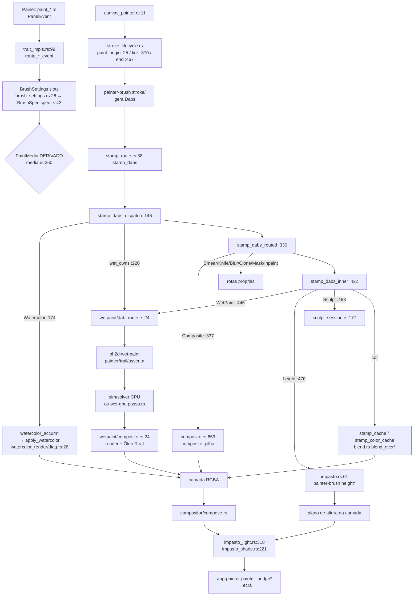

# F1 — Mapa do módulo Painter e os 4 modos (agente F1-B, 31/10)

> Leitor: a próxima LLM que vai planear a refatoração. Só LEITURA do código no ramo `line/PainterWatercolor`
> (HEAD `935f650ff8`). Números de LOC = `wc -l` sobre `.rs` (inclui comentários e testes inline). Caminhos
> relativos à raiz do repo; `T/` = `crates/ph2d-tool-painter/src/tool/paint/`.
> ⚠️ Fração teste/sonda é medida **por NOME de ficheiro** (`*_tests.rs`, `tests/`, `probe`, `sonda`, `_census`):
> testes inline em `#[cfg(test)] mod` (300 ficheiros têm um) contam como produção — o número real de produção é MENOR.

## 1. As crates

| Crate | LOC total | teste/sonda (por nome) | Responsabilidade |
|---|---:|---:|---|
| `ph2d-tool-painter` | 280 942 | 135 778 (48 %) + ~39 k em `T/measure_*`/`diag_*`/`*probe*`/`medida_*`/`look_*` | A FERRAMENTA: estado (`PainterTool`), roteamento do traço, os 4 meios (Watercolor e Impasto vivem AQUI, inteiros), camadas, compositor, undo, trilha de macro. |
| `ph2d-painter-brush` | 51 823 | 15 322 (30 %) | Motor de dab sem estado de app: `BrushSpec`, dab/stamp, stroke/método, textura (Grain), blend (24 modos Blender + pigmento), altura/impasto (height*), smear/blur/clone, espectral. |
| `ph2d-wet-paint` | 47 591 | 20 368 (43 %) | Motor de fluido (porte de JS «SPEC»): grid, solver, flow, drying, paper, trail, assenta, Óleo Real (luz/material/sombra), render. |
| `ph2d-panel-painter-layers` | 42 806 | 17 579 (41 %) | Painel Layers + todos os cartões do pincel (`paint_*.rs`): emite `PanelEvent`. |
| `ph2d-app-painter` | 23 963 | 10 555 (44 %) | Ponte ECS/shell: `painter_bridge*`, preview GPU, smokes por env var, macro_track. |
| `ph2d-painter-effects` | 6 642 | 177 (+2 512 em `adjustments/tests.rs`) | Ajustes/efeitos de camada (independente dos meios). |
| `ph2d-wet-gpu` | 4 198 | 1 451 | Passo do fluido na GPU (`passo.rs`, `seca.rs`, WGSL) — cópia GPU de `solver`/`drying`. |
| `ph2d-panel-wet-tuning` | 2 439 | 1 082 | Painel de knobs do `Tuning` do Wet Paint. |
| `ph2d-brush-presets` | 1 611 | 347 | Biblioteca/PNG/ordem de presets (sem deps PH2D). |
| `ph2d-paint-gpu` | 1 243 | 965 | Carimbo do Digital na GPU (`stamp.wgsl`). |
| `ph2d-pigment` | 516 | 0 | Kubelka–Munk de constante única + tabela sRGB (a porta ÚNICA da mistura K-M). |

### 1.1 Módulos de topo (LOC)

- **tool-painter/src**: `tool/` 214 425 (dos quais `tool/paint/` **207 337** em **355 entradas** num só diretório: `paint/tests` 33 627 · `wetpaint/` 27 319 · `wetpaint_preset/` 9 937 · `warp/` 6 567 · `sculpt_tests/` 5 576 · `layers/` 2 259) · `macro_track/` 12 319 · `ids/` 3 990 · `compositor/` 3 327 · `layers/` 2 259 · ~20 ficheiros `undo_*.rs` na raiz (~6 900) · `tests/` 34 498.
- **painter-brush/src**: `texture/` 5 288 · `stroke/` 5 071 · `dab/` 1 927 · `stamp_color/` 1 842 · `spec/` 665 · `stamp/` 592 + ~110 ficheiros planos (height*, blur_caixa*, smear*, solid*, ribbon*…).
- **wet-paint/src**: `solver/` 3 595 · `trail/` 3 099 · `grid/` 2 368 · `painter/` 1 509 · `assenta/` 1 410 · `tools/` 1 041 + planos (`render` 754, `assenta` 700, `painter` 693, `oleo_real` 688, `drying` 578, `paper` 390…) · `tests/` 11 086 · `examples/sonda_*` (≥ 2 100).
- **panel-painter-layers/src**: `paint_stroke/` 1 526 · `event/` 1 274 · `paint_*.rs` (um por cartão: brush, stroke, texture, impasto, watercolor, watercolor_paper, wetpaint, wetpaint_presets, composite, mask, shape, deform, selection, adjust…).

### 1.2 Grafo de dependências (só crates do Painter)

```
ph2d-pigment  ◄── ph2d-wet-paint ◄── ph2d-wet-gpu
     ▲                 ▲   ▲
     └── ph2d-painter-brush (dep de wet-paint!)
                 ▲     ▲
ph2d-painter-effects   │
     ▲                 │
ph2d-tool-painter ─────┴─ deps: painter-brush, wet-paint, wet-gpu, pigment, painter-effects, brush-presets
     ▲       ▲
     │   ph2d-paint-gpu (deps: painter-brush, tool-painter)
     │   ph2d-panel-wet-tuning (deps: wet-paint, tool-painter)
ph2d-panel-painter-layers (dep: tool-painter)
     ▲
ph2d-app-painter (deps: tool-painter, painter-brush, painter-effects, paint-gpu, panel-wet-tuning, panel-painter-layers, brush-presets)
```

⚠️ `ph2d-painter-brush` depende de `ph2d-wet-paint` (o motor de dab conhece o motor de fluido) — inversão:
a lei «pincel» está abaixo da lei «fluido» só por causa de tipos partilhados (papel/quantis, material).
⚠️ Os dois painéis dependem da crate da ferramenta inteira (281 k) — o painel não fala com um contrato pequeno.

## 2. O caminho de um traço

### 2.1 Tronco comum (os 4 meios + Composite)

| Salto | Onde |
|---|---|
| Cartão do painel emite `PanelEvent` | `crates/ph2d-panel-painter-layers/src/paint_{brush,watercolor,impasto,wetpaint,composite}.rs` |
| Ferramenta recebe | `tool/trait_impls.rs:37 handle_panel_event` → `:99 handle_panel_event_corpo` → cadeia `route_*_event` (`:82-88`): `T/watercolor_settings.rs:82`, `T/wetpaint_settings.rs:602`, `T/impasto_settings.rs:50`, … |
| Estado do pincel | `BrushSettings` `T/brush_settings.rs:26` (um `BrushSpec` por SLOT: `PAINT_MODE_COUNT=12` + Borracha + 5 da água, `T/paint_mode.rs:71-94`) → `BrushSpec` `crates/ph2d-painter-brush/src/spec.rs:43` |
| Meio (DERIVADO, nunca guardado) | `PaintMedia` `T/media.rs:28`, `paint_media()` `T/media.rs:250` lê `BrushSpec.watercolor`/`.impasto` + `WetPaintState::armed`; `set_paint_media` `:287` |
| Ponteiro | `T/canvas_pointer.rs:11 on_canvas_pointer` → `T/stroke_router.rs` (o que um Down significa) → `T/stroke_lifecycle.rs:25 paint_begin` / `:467 paint_end` / `:370 paint_tick` (via `tool/trait_impls.rs:45 on_tick`) |
| Dabs gerados | `crates/ph2d-painter-brush/src/stroke/` (método, espaçamento, jitter, simetria) com o spec de `T/dab_spec.rs:33 stroke_spec` |
| Porta do carimbo | `T/stamp_route.rs:38 stamp_dabs` (marca W9/W10, lote) → `:79 stamp_dabs_marcados` (Solid) → **`:146 stamp_dabs_dispatch`** |
| Roteador por MODO | `:330 stamp_dabs_routed` (Composite `:337`, pixel, smear `:350`, blur `:358`, clone `:365`, mask `:380`, inpaint `:386`, tiling `:390`) → **`:422 stamp_dabs_inner`** (wet `:445`, height `:470`, sculpt `:483`, pixel `:512`, cor por camadas `:552-560`, rampas `:588`, cache `:619`) |
| Composição p/ ecrã | `tool/runtime.rs:~490-583` (dirty-rect, `compositor::compose.rs:8/30/50 composite*`) + luz do relevo `apply_impasto_light` (`T/impasto_light.rs:318`, chamado em `tool/runtime.rs:337/527/583`, `tool/trait_impls_raster.rs:154-235`) → `ph2d-app-painter/src/painter_bridge*.rs` (upload, preview GPU) |

### 2.2 Por meio

| Meio | Desvio do tronco | Motor | Assenta / tempo | Composição |
|---|---|---|---|---|
| **Digital** | `stamp_dabs_inner` → rotas de `T/stamp_cache.rs:95/257`, `T/stamp_color_cache.rs:177`, rampas | `ph2d-painter-brush` `dab/`, `stamp/`, `stamp_color/`, `blend.rs:157 blend_over` / `:268 blend_over_pigmento`; cobertura `stroke_cover.rs:43/72`; GPU opcional `ph2d-paint-gpu/src/lib.rs:164` | sem tempo (o plano do traço `T/traco_plano/` só no Digital) | compositor de camadas |
| **Watercolor** | **curto-circuito** em `stamp_dabs_dispatch` `T/stamp_route.rs:174`: não carimba; acumula cobertura/cor | tudo NA FERRAMENTA: `T/watercolor_accum.rs:330`, `T/watercolor_accum_cor.rs:13`, `T/watercolor_mixer.rs`, `T/watercolor_mistura.rs`, `T/watercolor_field.rs`, `T/watercolor_lut.rs` (Beer–Lambert) | `T/watercolor_dry.rs:23 dry_canvas_wet`, `T/watercolor_secagem.rs:75`, `T/watercolor_backdrop.rs` | `apply_watercolor` em **`T/watercolor_render/diag.rs:26`** (sic: a função central mora num ficheiro chamado `diag`), chamado de `T/stroke_lifecycle.rs:231/357/458/516`, `T/stamp_preview.rs:352` |
| **Impasto** | o MESMO caminho do Digital + `stamp_dabs_height` `T/impasto.rs:61` (de `stamp_route.rs:470`); Sculpt `T/sculpt_session.rs:177`; Knife = smear com corpo | `ph2d-painter-brush` `height.rs`, `height_film.rs:49`, `height_push.rs`, `height_walk.rs`, `material.rs` | `T/impasto_settle.rs` (assenta sob o peso) | relevo dobrado `tool/layers/relief_fold.rs` → luz `T/impasto_light.rs:318` + `T/impasto_shade.rs:221 shade` (rig de lâmpadas, Phong-like, `MaterialBytes`) |
| **Wet Paint** | `wet_owns_the_dabs` `T/wetpaint/ciclo.rs:24` → `stamp_route.rs:220` (salta gates) → `:445` → `T/wetpaint/dab_route.rs:24 stamp_dabs_wetpaint` → `T/wetpaint/pousa_o_dab.rs` | `ph2d-wet-paint` (`painter`, `trail`, `brush`, `bristles_*`, `assenta`) ; passo CPU `sim`/`solver` ou GPU `ph2d-wet-gpu/src/passo.rs` (escolha `T/wetpaint/offthread/placa.rs:25`, `PH2D_WET_GPU`; `T/wetpaint/offthread.rs:296`) | contínuo a 40 Hz: `drying.rs:146 dry_cell` / `ph2d-wet-gpu/src/seca.rs` ; `T/wetpaint/cauda.rs` | `T/wetpaint/composite.rs:24 wetpaint_composite` → `ph2d_wet_paint::render::PigmentVisual` + Óleo Real (`oleo_real.rs`, `oleo_luz.rs:252 normal`, `material.rs:138 efectivo`) |
| **Composite** (upgrade do Brush, não meio) | `composite_active` `T/composite.rs:263` → `stamp_route.rs:337` → `T/composite.rs:659 stamp_dabs_composite` → `T/composite_pilha.rs` (recomposição por camada sobre a história do gesto) | reutiliza as rotas Brush/Smear/Blur/Erase do Digital; relevo próprio `T/composite_relevo.rs` | — | compositor |



### 2.3 Partilhado × cópia própria

- **Partilhado de verdade:** geração de dabs (`stroke/`), simetria/tiling/jitter, gates de máscara/seleção (exceto Wet/Watercolor, que os aplicam por si — `stamp_route.rs:208-219`), undo, camadas e compositor.
- **Cópia por meio:** (a) a forma como a tinta POUSA — 4 caminhos (blend_over do Digital · acumulação ótica da aquarela · height do Impasto · grid do Wet); (b) o TEMPO — 3 relógios (nenhum no Digital, `canvas_wet` da aquarela, sim 40 Hz do Wet); (c) a LUZ — 2 modelos (rig do Impasto vs Óleo Real); (d) a composição final — 3 portas (`compose`, `apply_watercolor`, `wetpaint_composite`).
- **Ramos por sentinela no tronco:** `stamp_dabs_dispatch` decide por predicados (`watercolor_render_active()`, `wet_owns_the_dabs()`, `traco_no_plano()`, `dual_na_ferramenta()`, `mangueira_viva()`, `wire_suppresses_dabs()`), e `stamp_dabs_inner` repete perguntas de modo; ordem dos `if` é a lei (comentada como tal).

## 3. Leis duplicadas

| Lei | Implementações (ficheiro:linha) | Mesma resposta? |
|---|---|---|
| **Mistura de cor** (5) | 1. RGB `blend_over` `ph2d-painter-brush/src/blend.rs:157` · 2. K-M `ph2d_pigment::mix_unit` `ph2d-pigment/src/lib.rs:153` (via `blend_over_pigment` `blend.rs:206/236`, `watercolor_mistura.rs:107`, wet `colorops.rs:74-80` re-exporta) · 3. espectral MyPaint `ph2d-painter-brush/src/espectral.rs:47/71` (flag `pigment_espectral`, porta `blend_over_pigmento` `blend.rs:268`) · 4. RYB `ryb_mix` `blend.rs:327` (usado só por `T/watercolor_mistura.rs:109`, que INTERPOLA RYB↔K-M pela água `:100-118`) · 5. pré-multiplicado dos núcleos Smear/Clone/Blur `ph2d-painter-brush/src/mistura.rs:11/27`; + K-M ponderado do wet `colorops.rs:380 km_weighted_mean_color` / `:402 km_glaze_channel_linear` e `velatura*` `:206-255` | NÃO: K-M é uma só porta (bom), mas espectral ≠ K-M (outra lei por flag) e a aquarela molhada mistura com RYB. ⚠️ O doc-comment de `blend_over_pigment` (`blend.rs:~195-200`) ainda diz «RYB», o código é K-M (`:236`) — comentário mente. |
| **Relevo / altura** (≥ 6) | 1. Impasto `ph2d-painter-brush/src/height.rs`, `height_film.rs:49 body_profile`, `height_push.rs`, `height_walk.rs` · 2. Wet/Óleo `ph2d-wet-paint/src/grid` (`Grid::relevo`) + `bristles_relevo.rs` · 3. dente do papel como relevo `T/substrate_relief.rs:145 tooth_px` · 4. `T/shape_relief.rs` · 5. `T/composite_relevo.rs` · 6. dobra entre camadas `tool/layers/relief_fold.rs` + `T/relief_fields.rs` | NÃO: dois campos de altura diferentes (plano por camada `u16`/f32 vs célula do grid f64), unidades diferentes; o Óleo Real não lê o `relief_fold`. |
| **Normal + luz** (2) | rig do Impasto `T/impasto_shade.rs:221 shade` + `T/impasto_light.rs:318/397` (com `MaterialBytes` `ph2d-painter-brush/src/material.rs:121`) · Óleo Real `ph2d-wet-paint/src/oleo_luz.rs:252 normal` (Sobel) + `oleo_real.rs` + `material.rs:138 efectivo` (Principled 8 nomes) | NÃO: dois modelos de material e dois de luz para o mesmo fenómeno (tinta grossa iluminada). |
| **Secagem** (4 + 1 GPU) | Wet `ph2d-wet-paint/src/drying.rs:146 dry_cell` · GPU `ph2d-wet-gpu/src/seca.rs:40` (cópia, parity por gate) · aquarela `T/watercolor_dry.rs:23` (decaimento de `canvas_wet`) · aquarela por poça `T/watercolor_secagem.rs:75` · Impasto `T/impasto_settle.rs` (assentar, não secar) | NÃO: a aquarela tem relógio próprio sem evaporação física; Digital/Impasto não secam. |
| **Papel / grão** (4) | Wet `ph2d-wet-paint/src/paper.rs:147 generate_paper_tile`, `:294 dente`, `paper_memo.rs:84` · aquarela `T/watercolor_noise.rs:220 paper_height` (hash noise) + `T/watercolor_field.rs:484 paper_h_px` · substrato `T/substrate_relief.rs:145/238/393` (Grain do `TextureSettings` + quantis do wet `:399`) · Grain do pincel `ph2d-painter-brush/src/texture.rs` (+ `T/dab_spec.rs:145 papel_como_grain`) · wet filme `T/wetpaint/grao_no_filme.rs:24` | NÃO: a aquarela tem o seu ruído; os outros já começam a convergir para o tile do wet (quantis). |
| **Opacidade / cobertura** (4) | Digital `ph2d-painter-brush/src/stroke_cover.rs:43 cover_add`/`:72 cover_max` · aquarela Beer–Lambert `T/watercolor_lut.rs:77 transmittance`/`:85 absorbance` · Wet `ph2d-wet-paint/src/opacity.rs:66 alpha_of_mass` (tabela saturante) + `material.rs:185 transparente` · Impasto `T/impasto_light.rs:89 paint_body(cover)`/`:111 gloss_body` | NÃO por desenho (cada meio tem a sua lei de massa→alfa); nenhuma porta comum «massa de pigmento → cobertura». |
| **Carimbo CPU/GPU** (2+2) | Digital CPU `stamp_color/` × `ph2d-paint-gpu/src/lib.rs:164` (`stamp.wgsl`) · Wet CPU `solver`/`drying` × `ph2d-wet-gpu/src/passo.rs`/`seca.rs` | Sim por gate de paridade («mesmo bit por placa»); são cópias legítimas, mas exigem tocar 2 sítios. |

## 4. Pontos de dor para manutenção por LLM

### 4.1 Tamanho
- Há um tecto de LOC por ficheiro (~700) na produção: **nenhum ficheiro de produção passa de 832** (`ph2d-wet-gpu/src/passo.rs`). O preço foi a fragmentação: **355 entradas num só diretório** (`T/`), e famílias partidas «pelo tecto», não por assunto (ex.: `impasto*.rs` = 12 ficheiros, `watercolor_*` = 33, `composite_*` = 11, `undo_*` na raiz = 20).
- Ficheiros > 1 500 linhas = **só testes** (8): `ph2d-painter-effects/src/adjustments/tests.rs` 2 512 · `T/tests/impasto_body/deposit.rs` 2 126 · `ph2d-painter-brush/src/stroke/tests.rs` 1 980 · `T/tests/watercolor_session.rs` 1 717 · `T/wetpaint/tests.rs` 1 703 · `T/tests/impasto_body/sculpting.rs` 1 703 · `ph2d-tool-painter/tests/it/familias/oleo_acrilica.rs` 1 669 · `T/tests/selection_editing.rs` 1 562.
- Maiores de produção (todos 687–832): `ph2d-wet-gpu/src/passo.rs` 832 · `ph2d-wet-paint/src/render.rs` 754 · `ph2d-wet-paint/src/assenta.rs` 700 · `T/state.rs` 700 · `ph2d-painter-brush/src/stamp_color/accumulate_batch.rs` 700 · `ph2d-tool-painter/src/undo_delta.rs` 699 · `T/solid_deposit.rs` 699 · `ph2d-wet-paint/src/trail/transfer.rs` 697 · `T/stamp_color_cache.rs` 697 · `ph2d-tool-painter/src/compositor/compose.rs` 697.
- **Instrumentação misturada com produção:** ~39 k linhas de `measure_*` (32 ficheiros), `diag_*` (19), `*probe*`, `medida_*`, `look_*`, `sonda_*` dentro de `T/` e `T/wetpaint/`; só 6 dos `mod` em `paint.rs` levam `#[cfg(test)]` explícito na linha anterior (os demais são gated noutro sítio ou estão sempre compilados — verificar).

### 4.2 Nomes e língua
- Mistura PT/EN no mesmo nível: `stamp_dabs_marcados`, `lote_no_plano`, `descarrega_o_dual`, `a_forca_mede_se`, `mangueira`, `po.rs`, `tampa.rs`, `veu.rs`, `fita.rs` ao lado de `stamp_cache`, `stroke_lifecycle`, `relief_fields`. `ph2d-wet-paint` idem (`assenta`, `estreito`, `lamina`, `par` ao lado de `solver`, `flow`, `trail`).
- Nomes que não dizem o que fazem: `T/watercolor_render/diag.rs` contém `apply_watercolor` (a porta central da aquarela); `T/mangueira.rs` (= ponta de N imagens); `T/uma_passagem.rs`; `ph2d-wet-paint/src/par.rs`, `estreito.rs`, `jsmath.rs`; `T/wetpaint/po.rs`; `T/inercia/`; `ph2d-painter-brush/src/capsula.rs`.
- `PaintMode` (12 ferramentas) vs `PaintMedia` (4 meios) vs slots (18) — três eixos com nomes quase iguais.

### 4.3 Ramos por sentinela / flags no BrushSpec
- O meio é derivado de **três** flags (`BrushSpec.watercolor`, `BrushSpec.impasto`, `WetPaintState::armed`) — `T/media.rs:10-13`. O tronco pergunta com predicados ad-hoc (`watercolor_render_active` em `T/watercolor_rewet_px.rs:22` — outra localização estranha — `wet_owns_the_dabs`, `impasto_visible` `T/impasto_light.rs:142`).
- `stroke_cover_wanted` `T/stamp_route.rs:298` é uma disjunção de 8 casos acumulados (Wash, borda_px, tecto_por_dab, Film AA…).

### 4.4 `PH2D_*` lidos no Painter (não-teste)

| Variável | Onde | Natureza |
|---|---|---|
| `PH2D_WET_GPU` | `T/wetpaint/offthread/placa.rs:25` | ⚠️ **comportamento**: escolhe passo GPU do Wet |
| `PH2D_COMPOSITE_REPLAY` | `T/state_default.rs:273` | ⚠️ **comportamento**: pilha do Composite por replay |
| `PH2D_BLUR_SEM_FUSAO` | `ph2d-painter-brush/src/blur_caixa.rs:271` | ⚠️ comportamento (variante do blur) |
| `PH2D_PAINT_FULL_UPLOAD` | `ph2d-app-painter/src/painter_bridge_upload.rs:91` | comportamento de upload (perf) |
| `PH2D_UNDO_AUDIT` · `PH2D_INVALIDATE_TRACE` · `PH2D_RIBBON_DIAG` · `PH2D_SEL_GIZMO_DIAG` · `PH2D_PREVIEW_DUMP` · `PH2D_PREVIEW_DIAG` · `PH2D_PAINT_PERF` | `tool/undo_audit.rs:43`, `tool/layers/cache.rs:30`, `T/ribbon_diag.rs:50`, `T/selection_input.rs:18`, `painter_bridge.rs:325/385`, `paint_perf.rs:198` | diagnóstico |
| `PH2D_{IMPASTO,TAPER,MASK,COMPOSITE,SUBSTRATE,WETPAINT,LINE,MACRO,OBJECT_MODE}_SMOKE`, `PH2D_COMPOSITE_{PICKER,RABISCO}`, `PH2D_MACRO_{TUTORIAL,CAMINHO}` | `ph2d-app-painter/src/*_smoke.rs`, `macro_track/{smoke,caminho}.rs`, `paint_mode.rs:135` | cenas de smoke |
| `PH2D_OLEO_*` (PNG, CENA, VARIANTES, S2_RAIO, CREME, MODOS, ACUMULO_TRACO, AF, FACA_H3, SO) | `T/wetpaint_preset/medida_*.rs` | medição (estão em `src/`, não em `tests/`) |

Nos testes/sondas há mais **~110** nomes (`PH2D_SONDA_*` ×≈50, `PH2D_OLEO_*`, `PH2D_DIAG_*`, `PH2D_AUDIT_*`, `PH2D_*_LOOK_DIR`…) e dois sem prefixo (`PROBE_R`, `PROBE_PASSES` em `T/composite_probe.rs:77/345`).

### 4.5 Código morto / doc que mente (aparente, verificar antes de cortar)
- `ryb_mix` (`blend.rs:327`) tem UM chamador (aquarela molhada); doc de `blend_over_pigment` descreve RYB que já não existe.
- `PaintMode::Selection` doc (`T/paint_mode.rs:25-29`) diz «paints nothing… engine lands in a follow-up», mas há ~15 ficheiros `selection_*` — doc velho.
- `apply_watercolor(false)` «the frozen legacy route» `T/stroke_lifecycle.rs:357` — rota legada viva.
- `T/watercolor_flow_classico.rs` ao lado de `watercolor_flow.rs` — duas versões.

## 5. Proposta de ÁRVORE-ALVO (proposta, não decisão)

Princípio: **uma lei por área; os 4 meios são PONTOS no espaço de parâmetros (presets), não ramos.** O traço
passa SEMPRE pelos mesmos 5 estágios; um meio só escolhe valores (e, quando inevitável, uma estratégia
registada por tabela, nunca um `if` no tronco).

```
crates/
  ph2d-paint-core/        (novo, folha; ~tipos)  Massa, Cor, Pigmento, Altura, Água — unidades e tipos comuns
  ph2d-paint-tinta/       ← ph2d-pigment + blend.rs + espectral.rs + mistura.rs + colorops (K-M) + opacity.rs
                            + stroke_cover + watercolor_lut (Beer-Lambert) + material (as 2) → UMA porta
                            `mistura(lei, a, b, t)` e UMA `cobertura(massa, lei)`; RYB vira lei nomeada ou sai
  ph2d-paint-pincel/      ← painter-brush: spec/ stroke/ dab/ stamp*/ texture/ symmetry/ jitter/ smear*/ blur*/ clone
                            (sem height*, sem dep de wet-paint) + wet-paint brush/ bristles_* (cerdas = ponta)
  ph2d-paint-superficie/  ← papel: wet-paint paper.rs/paper_memo + watercolor_noise + substrate_relief + grão
                            relevo: height*.rs + Grid::relevo + relief_fold + shape_relief + composite_relevo
                            → UM campo de altura por camada, UMA dobra
  ph2d-paint-tempo/       ← wet-paint grid/ sim/ solver/ flow/ trail/ drying/ assenta/ + watercolor_dry/secagem/
                            backdrop + impasto_settle → um relógio; Digital = água 0, Aquarela = sim óptica rasa,
                            Impasto = sem água + assenta; ph2d-wet-gpu fica como backend GPU DESTA crate
  ph2d-paint-luz/         ← impasto_light/shade/rig + oleo_real/oleo_luz/oleo_sombra/oleo_material/oleo_vista
                            → um material (Principled simplificado) e uma luz; o rig do Impasto vira preset
  ph2d-tool-painter/      só a FERRAMENTA: ponteiro, lifecycle, roteador por PaintMode (Smear/Blur/Clone/
                            Mask/Inpaint/Fill/Selection/Deform/Sculpt/Knife), camadas, compositor, undo.
                            Subpastas por assunto: tool/{entrada,traco,rotas,selecao,formas(curve/line/shape),
                            deform(warp),composite,camadas,undo,macro}/ ; os meios saem daqui
  ph2d-paint-meios/       (ou pasta em tool-painter) os 4 meios + Composite como DADOS: tabela
                            Meio → {lei de mistura, lei de cobertura, água, relevo, luz, tempo} + presets
  ph2d-paint-sondas/      (crate dev-only) ← todos os measure_*/diag_*/probe*/sonda*/medida_*/look_* (~39 k + examples)
  ph2d-panel-painter-*/   painéis dependem de um contrato pequeno (eventos + snapshot), não da ferramenta inteira
```

| Sai de | Vai para |
|---|---|
| `T/watercolor_*` (33 ficheiros) | `tinta` (LUT, mistura), `superficie` (ruído/papel), `tempo` (dry/secagem/backdrop/flow), `meios` (preset Aquarela) |
| `T/impasto*` (12) + `painter-brush/height*` | `superficie` (altura), `luz` (light/shade/rig), `tempo` (settle), `meios` |
| `T/wetpaint/` (27 k) | ponte fina em `tool-painter` (sessão, offthread, composite) + `meios`; física já em `tempo` |
| `ph2d-wet-paint/oleo_*` | `luz` |
| `ph2d-wet-paint/{paper,paper_memo}` | `superficie` |
| `ph2d-pigment`, `colorops` K-M, `espectral`, `mistura`, `opacity` | `tinta` |
| sentinelas em `stamp_route.rs:146-252/422-620` | tabela de estratégia por meio (`meios`) consultada UMA vez no `paint_begin` |
| `PH2D_WET_GPU`, `PH2D_COMPOSITE_REPLAY`, `PH2D_BLUR_SEM_FUSAO` | campo de configuração explícito (ou remoção após decisão medida) |

Ordem sugerida (cada passo byte-idêntico, com os gates existentes como rede): 1) sondas para crate dev-only
(só move) · 2) `tinta` (já há porta K-M única — consolidar o resto) · 3) `superficie`/papel · 4) `luz` (a mais
arriscada: dois modelos) · 5) `tempo` · 6) meios como dados + roteador sem sentinela.
