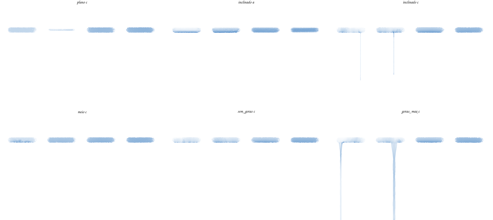
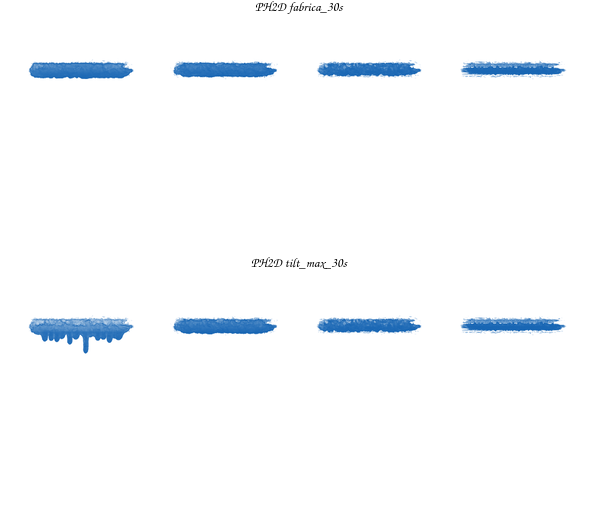

# 06 — As gotas (escorrimento): a lei do Rebelle e a nossa (2026-10-08)

> Pedido do dono (08/10), sobre um borrão do Wet Paint com gotas grossas: *«investigue no Rebelle se a
> tendência ao escorrimento da tinta ocorre como no nosso app. Se para cada pincel a gravidade ou outros
> aspectos são configurados.»* Método: DADOS do produto (os 281 presets, as definições, o manual que vem
> com ele) e uma BANCADA corrida pela porta oficial (Motion IO por WebSocket) sobre gestos nossos — nada
> do executável. Fixtures: [`fixtures/rebelle_gotas/`](fixtures/rebelle_gotas/README.md).

## §1 — Resposta curta

1. **No Rebelle a gravidade NÃO é do pincel.** Nenhum dos 281 presets tem gravidade, gotas ou fluxo; o
   pincel só leva a **água** (`volume_params.water`, 172 presets; 5 com `length_water_reduction`).
2. **O escorrimento é da TELA**: o painel **Tilt** (ligar/desligar, direcção e ângulo; *Lock to Canvas*,
   acelerómetro), **desligado por omissão**. Manual: *«The speed of the color runoff depends on the tilt of
   the canvas, amount of water and color on the painting.»*
3. **A forma das gotas é do PAPEL**: *Visual Settings → Watercolor Behavior*, um preset por papel (Default,
   Hot Pressed, Cold Pressed, Rough, Japanese): **Create Drips** (on/off), **Drip Size** e **Drip Length**
   (1–10, 5 por omissão), mais Absorbency, Re-wet, Texture Influence, Edge Darkening, Diffusion Speed,
   Granulation. Na porta: `SET_CANVAS_TILT {tilt:{x,y}∈[-1,1], enabled}` e `SET_ENGINE_PARAMS
   {create_drips, drip_size, drip_length, …}`.
4. **A água de fábrica dos pincéis de aquarela é BAIXA**: Round 29, Wash Round 24, Mop 34, Flat 39, Flat 2
   e Bristle 9, Dip Pen 49 (de 100). O nosso Wet Round leva água **100**.

## §2 — A bancada (Rebelle 8.3.4, 08/10)

Quatro traços horizontais de 150 px a 40 px (Watercolor/Round, água 100 · 70 · 40 · 20), tela branca
1000×640, ~1 min de água. Gota mais longa abaixo do traço, em px da tela:

| tela | água 100 | 70 | 40 | 20 | o que se vê |
|---|---|---|---|---|---|
| Tilt desligado | 0 | 0 | 0 | 0 | nada corre; os traços secam no lugar |
| Tilt (0, 1) — o máximo | **283** | **249** | 0 | 0 | o pigmento desce para a orla de baixo do traço; depois **UMA gota fina e recta** (1–3 px) nos dois mais molhados |
| Tilt (0, 0,5) | 0 | 0 | 0 | 0 | só a orla de baixo escurece |
| Tilt máx., Create Drips **off** | 0 | 0 | 0 | 0 | a orla de baixo escurece, sem fios |
| Tilt máx., Drip Size/Length **10/10** | **463** | **465** | 0 | 0 | um **funil** largo que afina até ao fundo da tela |
| Tilt máx., água DO PRESET | Round **302** | Wash Round 0 | Mop 0 | Dip Pen 0 | o Wash e o Mop esbatem sem gotas; a tinta da pena não corre |



## §3 — O nosso (Wet Paint, a mesma bancada: `tests/it/sonda_gotas.rs`)

Mesmos traços, água 1,0 · 0,7 · 0,4 · 0,2, relógio fixo, 30 s:

| inclinação | água 1,0 | 0,7 | 0,4 | 0,2 |
|---|---|---|---|---|
| a de FÁBRICA do nosso dial (ligado, para baixo, metade) | 0 | 0 | 0 | 0 |
| desligada | 0 | 0 | 0 | 0 |
| no máximo (anel 8) | **20** | 0 | 0 | 0 |



- Um traço isolado quase não escorre; quando escorre, é um **PENTE de dedos curtos e grossos** ao longo da
  orla de baixo — não uma gota longa e fina. As gotas grossas do borrão do dono vêm da água ACUMULADA de
  muitos traços sobrepostos (a poça), não de um traço.
- Os dois knobs ESCONDIDOS que modulam a gravidade em fios (`extFingering`, `extRivulets`, `solver.rs`)
  **não fazem gotas** (fios 15 e 40 contra o controlo pelo mesmo caminho: 0 / 0 / 0 / 0 e a mesma tinta,
  11 850 contra 11 855 px). ⇒ a gota do Rebelle é um MECANISMO que o nosso solver não tem, não um ajuste.

## §4 — As diferenças, uma a uma

| | Rebelle | PH2D hoje |
|---|---|---|
| quem decide se corre | a TELA (Tilt), desligada por omissão | o dial de inclinação, **ligado** por omissão, + o knob **Gravity por pincel** (no preset) |
| quem decide a forma da gota | o PAPEL (Create Drips, Size, Length) | ninguém (sai do solver) |
| o pincel | só a água (aquarela de fábrica 9–49) | água + gravidade (os nossos presets: 1,0, o Dry Brush 0,2) |
| forma | 1–2 gotas por traço molhado, finas e longas (ou funil com 10/10) | pente de dedos curtos e grossos; gotas longas só de poças |
| dentro do traço | o pigmento desce para a orla de baixo mesmo sem gotas | (não medido em separado) |

## §5 — Proposta (decisão do dono)

Seguir a lei do Rebelle, por partes, cada uma com a sua barra tirada deste vale:

1. **A gravidade sai do pincel e vai para a TELA**: o nosso dial de inclinação já existe e passa a ser o
   único dono do «corre ou não», com o Rebelle **desligado por omissão**; o knob `gravity` deixa o preset
   (o `Wet Drip` passa a ser «muita água», não «muita gravidade»).
2. **As gotas passam a ser do PAPEL**: Create Drips, Drip Size e Drip Length na obra (com o papel), como
   o Rebelle.
3. **A água de fábrica dos presets desce** para a faixa do Rebelle (aquarela 0,1–0,5).
4. **O mecanismo da gota** (poucas gotas finas e longas a partir da orla de baixo de uma área molhada,
   funil com Size/Length altos) é trabalho de MOTOR, em ficheiro irmão do solver, com a bancada deste doc
   como gate: inclinado máx. ⇒ gota ≥ 250 px nos traços de água ≥ 0,7 e 0 nos de 0,4; Tilt desligado ou a
   meio ⇒ 0; Create Drips off ⇒ 0 com a orla de baixo escura.

Cabe na **W7** do plano (água como volume, «gotas, blow, tilt da tela» — 03 §3.9 dava-as como não
medidas); os pontos 1–3 podem vir antes, por serem leves.

## §6 — Como repetir

```
bash ferramentas/gotas_inicia.sh &          # UMA tela virtual com o Rebelle e a porta ligada
#   passar o Registration e o New Artwork: as duas primeiras etapas do ~/Apps/rebelle/oraculo/arranque.sh
bash ferramentas/gotas_tela.sh inclinado --tilt 0 1          # (e as outras linhas da §2)
bash ferramentas/gotas_fecha.sh             # ⛔ nunca o fecha.sh do oráculo: mata TODA tela virtual
PH2D_SONDA_OUT=/tmp/x cargo test -p ph2d-tool-painter --profile smoke --test it sonda_gotas -- --ignored --nocapture
```

⚠️ O `arranque.sh` do oráculo lança o Rebelle em `DISPLAY=:1` escrito à mão — com outra linha a usar uma
tela virtual, cairia na dela. A sessão das gotas lê o ecrã do `display.txt`.
