# Pranchas antes/depois — missão Painter 4K

Uma secção por mudança de aparência. Cada imagem: antes à esquerda, depois ao meio (ou à direita), diferença em vermelho quando há. Fundos: branco, blocos de cor, papel Textured; 1080p e 4K. Detalhe em cada `README.md`.
Relatório dos pincéis de fábrica (antes/depois): `target/relatorio-pinceis/index.html` (gerado pelos dois alarmes; nada foi regravado).

## B06a — A Borracha tira o relevo junto com a tinta

Antes ficava um «tubo» de relevo onde a cor já tinha saído. Agora, onde a cor sai, o relevo sai também (Impasto e Wet).

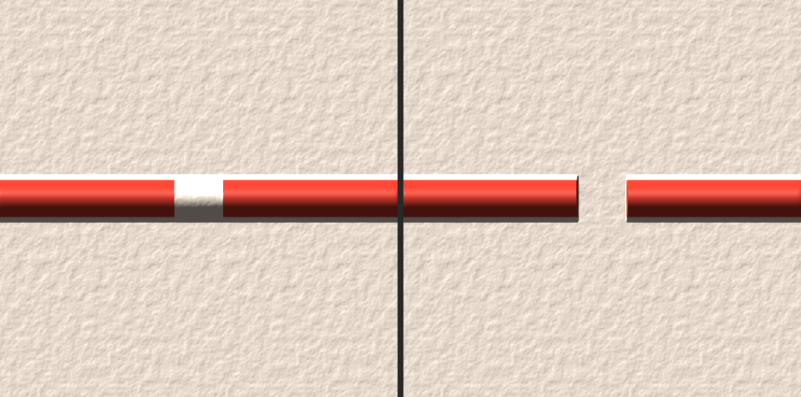

Todas: [1080p_blocos_antes_depois](B06a/1080p_blocos_antes_depois.png) · [1080p_branco_antes_depois](B06a/1080p_branco_antes_depois.png) · [1080p_papel_antes_depois](B06a/1080p_papel_antes_depois.png) · [1080p_wet_blocos_antes_depois](B06a/1080p_wet_blocos_antes_depois.png) · [1080p_wet_branco_antes_depois](B06a/1080p_wet_branco_antes_depois.png) · [1080p_wet_papel_antes_depois](B06a/1080p_wet_papel_antes_depois.png) · [4k_blocos_antes_depois](B06a/4k_blocos_antes_depois.png) · [4k_branco_antes_depois](B06a/4k_branco_antes_depois.png) · [4k_papel_antes_depois](B06a/4k_papel_antes_depois.png) · [4k_wet_blocos_antes_depois](B06a/4k_wet_blocos_antes_depois.png) · [4k_wet_branco_antes_depois](B06a/4k_wet_branco_antes_depois.png) · [4k_wet_papel_antes_depois](B06a/4k_wet_papel_antes_depois.png) · [notas](B06a/README.md)

## B02-cont — Ctrl+Z além do limite não congela a aguada

Antes o desfazer parava a água longe do traço desfeito, que ficava em riscas. Agora só o traço desfeito some; o resto continua a correr.

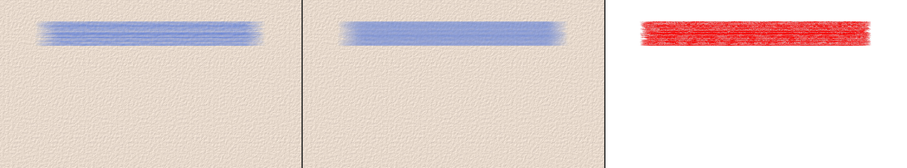

Todas: [1080p_blocos_antes_depois](B02-cont/1080p_blocos_antes_depois.png) · [1080p_branco_antes_depois](B02-cont/1080p_branco_antes_depois.png) · [1080p_papel_antes_depois](B02-cont/1080p_papel_antes_depois.png) · [4k_blocos_antes_depois](B02-cont/4k_blocos_antes_depois.png) · [4k_branco_antes_depois](B02-cont/4k_branco_antes_depois.png) · [4k_papel_antes_depois](B02-cont/4k_papel_antes_depois.png) · [notas](B02-cont/README.md)

## B24 — Blur do Composite Brush: borda limpa e cresce com o pincel

Antes a borda do Blur numa camada vazia ficava acinzentada, e o Blur parava de crescer acima de ~94 px. Agora a borda sai na cor da tinta e o Blur acompanha o tamanho.

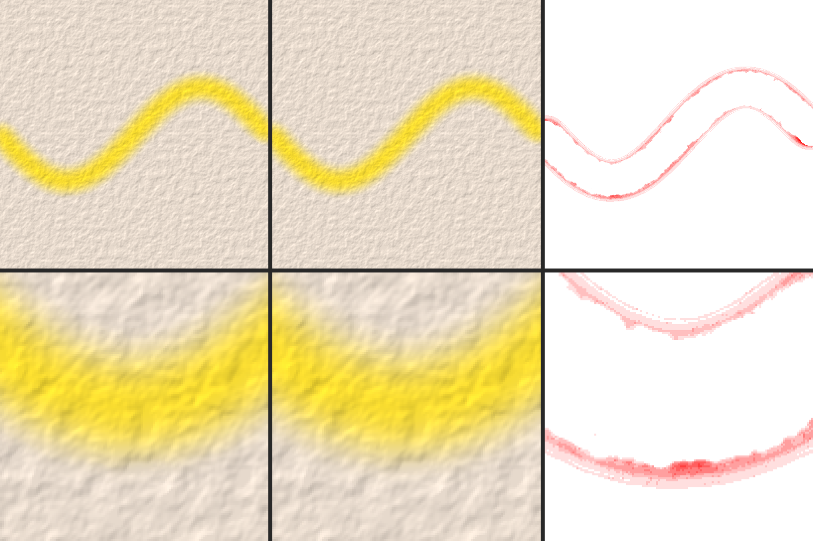

Todas: [1080p_blocos_antes_depois](B24/1080p_blocos_antes_depois.png) · [1080p_branco_antes_depois](B24/1080p_branco_antes_depois.png) · [1080p_papel_antes_depois](B24/1080p_papel_antes_depois.png) · [4k_blocos_antes_depois](B24/4k_blocos_antes_depois.png) · [4k_branco_antes_depois](B24/4k_branco_antes_depois.png) · [4k_papel_antes_depois](B24/4k_papel_antes_depois.png) · [b24_5_1080p_blocos_antes_depois](B24/b24_5_1080p_blocos_antes_depois.png) · [b24_5_1080p_branco_antes_depois](B24/b24_5_1080p_branco_antes_depois.png) · [b24_5_1080p_papel_antes_depois](B24/b24_5_1080p_papel_antes_depois.png) · [b24_5_4k_blocos_antes_depois](B24/b24_5_4k_blocos_antes_depois.png) · [b24_5_4k_branco_antes_depois](B24/b24_5_4k_branco_antes_depois.png) · [b24_5_4k_papel_antes_depois](B24/b24_5_4k_papel_antes_depois.png) · [notas](B24/README.md)

## B14b — Óleo Real: luz simples enquanto o pincel está na tela

Durante a pincelada a luz é a simples (sombras um pouco mais riscadas); ao soltar, volta a completa, igual à de antes. Decisão 2.

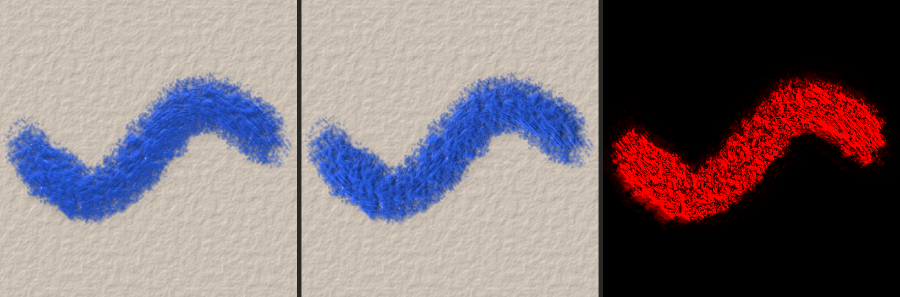

Todas: [1080p_blocos_antes_depois](B14b/1080p_blocos_antes_depois.png) · [1080p_branco_antes_depois](B14b/1080p_branco_antes_depois.png) · [1080p_papel_antes_depois](B14b/1080p_papel_antes_depois.png) · [4k_blocos_antes_depois](B14b/4k_blocos_antes_depois.png) · [4k_branco_antes_depois](B14b/4k_branco_antes_depois.png) · [4k_papel_antes_depois](B14b/4k_papel_antes_depois.png) · [notas](B14b/README.md)

## B06b — Warp em malha leva o relevo junto

Antes a tinta saltava para trás ao entrar no Warp e o relevo ficava parado. Agora tinta e relevo dobram juntos, sem risca.

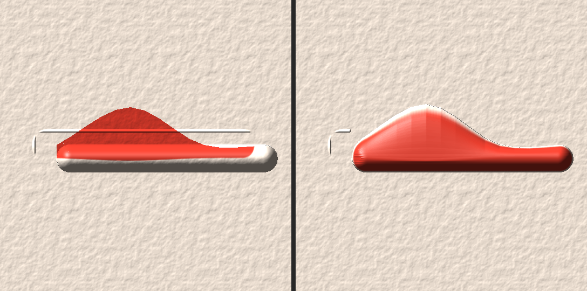

Todas: [1080p_blocos_antes_depois](B06b/1080p_blocos_antes_depois.png) · [1080p_branco_antes_depois](B06b/1080p_branco_antes_depois.png) · [1080p_papel_antes_depois](B06b/1080p_papel_antes_depois.png) · [4k_blocos_antes_depois](B06b/4k_blocos_antes_depois.png) · [4k_branco_antes_depois](B06b/4k_branco_antes_depois.png) · [4k_papel_antes_depois](B06b/4k_papel_antes_depois.png) · [notas](B06b/README.md)

## B40a — Color Fill, Cut e Trim respeitam trinco, máscara e laço

Com o alfa travado ou a máscara de proteção, o Color Fill e o Cut só mexem onde podem. O Trim com Offset 0 já não apaga um laço.

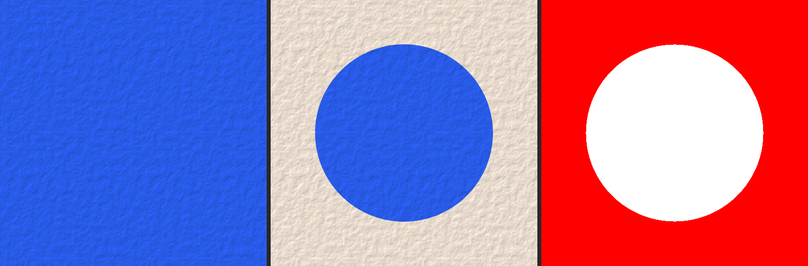

Todas: [1080p_blocos_colorfill_trinco_antes_depois](B40a/1080p_blocos_colorfill_trinco_antes_depois.png) · [1080p_blocos_cut_protegido_antes_depois](B40a/1080p_blocos_cut_protegido_antes_depois.png) · [1080p_blocos_trim_offset_zero_antes_depois](B40a/1080p_blocos_trim_offset_zero_antes_depois.png) · [1080p_branco_colorfill_trinco_antes_depois](B40a/1080p_branco_colorfill_trinco_antes_depois.png) · [1080p_branco_cut_protegido_antes_depois](B40a/1080p_branco_cut_protegido_antes_depois.png) · [1080p_branco_trim_offset_zero_antes_depois](B40a/1080p_branco_trim_offset_zero_antes_depois.png) · [1080p_papel_colorfill_trinco_antes_depois](B40a/1080p_papel_colorfill_trinco_antes_depois.png) · [1080p_papel_cut_protegido_antes_depois](B40a/1080p_papel_cut_protegido_antes_depois.png) · [1080p_papel_trim_offset_zero_antes_depois](B40a/1080p_papel_trim_offset_zero_antes_depois.png) · [4k_blocos_colorfill_trinco_antes_depois](B40a/4k_blocos_colorfill_trinco_antes_depois.png) · [4k_blocos_cut_protegido_antes_depois](B40a/4k_blocos_cut_protegido_antes_depois.png) · [4k_blocos_trim_offset_zero_antes_depois](B40a/4k_blocos_trim_offset_zero_antes_depois.png) · [4k_branco_colorfill_trinco_antes_depois](B40a/4k_branco_colorfill_trinco_antes_depois.png) · [4k_branco_cut_protegido_antes_depois](B40a/4k_branco_cut_protegido_antes_depois.png) · [4k_branco_trim_offset_zero_antes_depois](B40a/4k_branco_trim_offset_zero_antes_depois.png) · [4k_papel_colorfill_trinco_antes_depois](B40a/4k_papel_colorfill_trinco_antes_depois.png) · [4k_papel_cut_protegido_antes_depois](B40a/4k_papel_cut_protegido_antes_depois.png) · [4k_papel_trim_offset_zero_antes_depois](B40a/4k_papel_trim_offset_zero_antes_depois.png) · [notas](B40a/README.md)

## B19a — Recorte, Shadows/Highlights, lente e desfoque

Recorte sobre camada escondida ou a 0 % segue a forma; ruído quase preto clareia em cinza, não em cores vivas; a franja da lente centra na tela; o desfoque já não deixa costura.

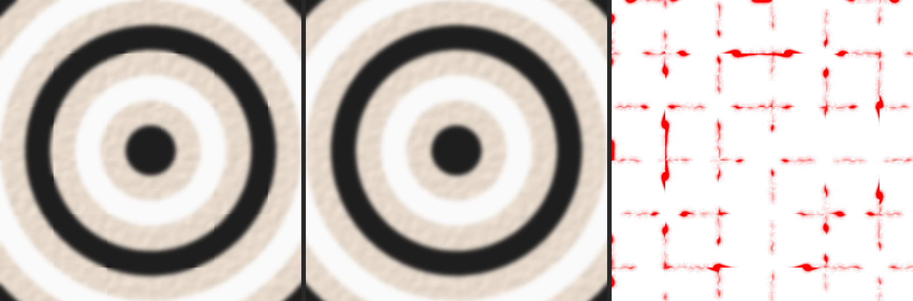

Todas: [1080p_blocos_desfoque_janela_sem_costura_antes_depois](B19a/1080p_blocos_desfoque_janela_sem_costura_antes_depois.png) · [1080p_blocos_lente_centro_da_tela_antes_depois](B19a/1080p_blocos_lente_centro_da_tela_antes_depois.png) · [1080p_blocos_recorte_base_escondida_antes_depois](B19a/1080p_blocos_recorte_base_escondida_antes_depois.png) · [1080p_blocos_recorte_base_opacidade0_antes_depois](B19a/1080p_blocos_recorte_base_opacidade0_antes_depois.png) · [1080p_blocos_sombras_ruido_quase_preto_antes_depois](B19a/1080p_blocos_sombras_ruido_quase_preto_antes_depois.png) · [1080p_branco_desfoque_janela_sem_costura_antes_depois](B19a/1080p_branco_desfoque_janela_sem_costura_antes_depois.png) · [1080p_branco_lente_centro_da_tela_antes_depois](B19a/1080p_branco_lente_centro_da_tela_antes_depois.png) · [1080p_branco_recorte_base_escondida_antes_depois](B19a/1080p_branco_recorte_base_escondida_antes_depois.png) · [1080p_branco_recorte_base_opacidade0_antes_depois](B19a/1080p_branco_recorte_base_opacidade0_antes_depois.png) · [1080p_branco_sombras_ruido_quase_preto_antes_depois](B19a/1080p_branco_sombras_ruido_quase_preto_antes_depois.png) · [1080p_papel_desfoque_janela_sem_costura_antes_depois](B19a/1080p_papel_desfoque_janela_sem_costura_antes_depois.png) · [1080p_papel_lente_centro_da_tela_antes_depois](B19a/1080p_papel_lente_centro_da_tela_antes_depois.png) · [1080p_papel_recorte_base_escondida_antes_depois](B19a/1080p_papel_recorte_base_escondida_antes_depois.png) · [1080p_papel_recorte_base_opacidade0_antes_depois](B19a/1080p_papel_recorte_base_opacidade0_antes_depois.png) · [1080p_papel_sombras_ruido_quase_preto_antes_depois](B19a/1080p_papel_sombras_ruido_quase_preto_antes_depois.png) · [4k_blocos_desfoque_janela_sem_costura_antes_depois](B19a/4k_blocos_desfoque_janela_sem_costura_antes_depois.png) · [4k_blocos_lente_centro_da_tela_antes_depois](B19a/4k_blocos_lente_centro_da_tela_antes_depois.png) · [4k_blocos_recorte_base_escondida_antes_depois](B19a/4k_blocos_recorte_base_escondida_antes_depois.png) · [4k_blocos_recorte_base_opacidade0_antes_depois](B19a/4k_blocos_recorte_base_opacidade0_antes_depois.png) · [4k_blocos_sombras_ruido_quase_preto_antes_depois](B19a/4k_blocos_sombras_ruido_quase_preto_antes_depois.png) · [4k_branco_desfoque_janela_sem_costura_antes_depois](B19a/4k_branco_desfoque_janela_sem_costura_antes_depois.png) · [4k_branco_lente_centro_da_tela_antes_depois](B19a/4k_branco_lente_centro_da_tela_antes_depois.png) · [4k_branco_recorte_base_escondida_antes_depois](B19a/4k_branco_recorte_base_escondida_antes_depois.png) · [4k_branco_recorte_base_opacidade0_antes_depois](B19a/4k_branco_recorte_base_opacidade0_antes_depois.png) · [4k_branco_sombras_ruido_quase_preto_antes_depois](B19a/4k_branco_sombras_ruido_quase_preto_antes_depois.png) · [4k_papel_desfoque_janela_sem_costura_antes_depois](B19a/4k_papel_desfoque_janela_sem_costura_antes_depois.png) · [4k_papel_lente_centro_da_tela_antes_depois](B19a/4k_papel_lente_centro_da_tela_antes_depois.png) · [4k_papel_recorte_base_escondida_antes_depois](B19a/4k_papel_recorte_base_escondida_antes_depois.png) · [4k_papel_recorte_base_opacidade0_antes_depois](B19a/4k_papel_recorte_base_opacidade0_antes_depois.png) · [4k_papel_sombras_ruido_quase_preto_antes_depois](B19a/4k_papel_sombras_ruido_quase_preto_antes_depois.png) · [notas](B19a/README.md)

## B49-cont — Pó do papel (Pastel, Chalk, Crayon) só onde o traço passa

Mais rápido ao encostar a caneta em 4K (6,65 → 2,62 ms). A diferença é invisível: no máximo 1 nível num ponto em 4K.

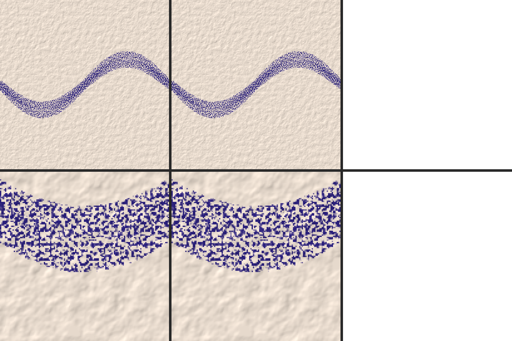

Todas: [1080p_blocos_antes_depois](B49-cont/1080p_blocos_antes_depois.png) · [1080p_branco_antes_depois](B49-cont/1080p_branco_antes_depois.png) · [1080p_papel_antes_depois](B49-cont/1080p_papel_antes_depois.png) · [4k_blocos_antes_depois](B49-cont/4k_blocos_antes_depois.png) · [4k_branco_antes_depois](B49-cont/4k_branco_antes_depois.png) · [4k_papel_antes_depois](B49-cont/4k_papel_antes_depois.png) · [notas](B49-cont/README.md)

## B40b — Formas: simetria no 1.º ponto e proteção no modo Mask

A Line com simetria agora espelha o primeiro ponto. Uma forma desenhada no Mask passa a proteger.

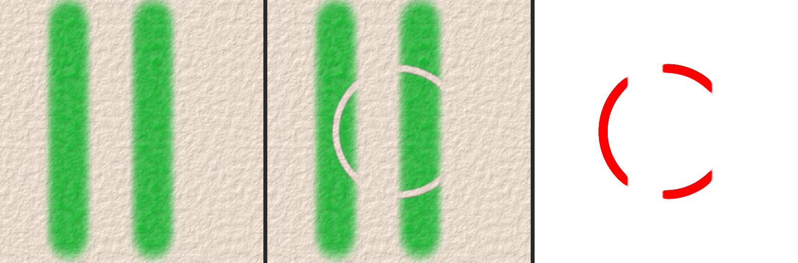

Todas: [1080p_blocos_forma_no_mask_antes_depois](B40b/1080p_blocos_forma_no_mask_antes_depois.png) · [1080p_blocos_linha_simetria_antes_depois](B40b/1080p_blocos_linha_simetria_antes_depois.png) · [1080p_branco_forma_no_mask_antes_depois](B40b/1080p_branco_forma_no_mask_antes_depois.png) · [1080p_branco_linha_simetria_antes_depois](B40b/1080p_branco_linha_simetria_antes_depois.png) · [1080p_papel_forma_no_mask_antes_depois](B40b/1080p_papel_forma_no_mask_antes_depois.png) · [1080p_papel_linha_simetria_antes_depois](B40b/1080p_papel_linha_simetria_antes_depois.png) · [4k_blocos_forma_no_mask_antes_depois](B40b/4k_blocos_forma_no_mask_antes_depois.png) · [4k_blocos_linha_simetria_antes_depois](B40b/4k_blocos_linha_simetria_antes_depois.png) · [4k_branco_forma_no_mask_antes_depois](B40b/4k_branco_forma_no_mask_antes_depois.png) · [4k_branco_linha_simetria_antes_depois](B40b/4k_branco_linha_simetria_antes_depois.png) · [4k_papel_forma_no_mask_antes_depois](B40b/4k_papel_forma_no_mask_antes_depois.png) · [4k_papel_linha_simetria_antes_depois](B40b/4k_papel_linha_simetria_antes_depois.png) · [notas](B40b/README.md)

## B22.2 — Spray parado igual a 30, 60 e 144 quadros/s

Antes, num monitor a 30 q/s, a nuvem saía mais fraca. Agora é a mesma em qualquer monitor; a 60 e 144 nada muda. Decisão 8.

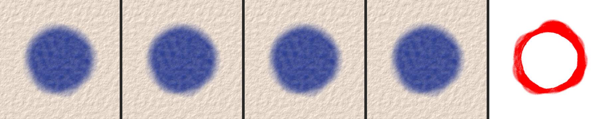

Todas: [1080p_blocos_30_60_144](B22.2/1080p_blocos_30_60_144.png) · [1080p_branco_30_60_144](B22.2/1080p_branco_30_60_144.png) · [1080p_papel_30_60_144](B22.2/1080p_papel_30_60_144.png) · [4k_blocos_30_60_144](B22.2/4k_blocos_30_60_144.png) · [4k_branco_30_60_144](B22.2/4k_branco_30_60_144.png) · [4k_papel_30_60_144](B22.2/4k_papel_30_60_144.png) · [notas](B22.2/README.md)

## B33 — Papel sem repetição a cada 256 px

Antes o desenho do papel repetia-se em ladrilhos de 256 px. Agora não se nota repetição; grão e força iguais. Decisão 7b.

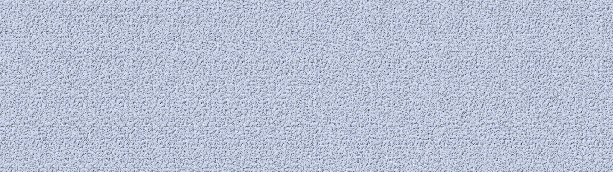

Todas: [1080p_blocos_antes_depois](B33/1080p_blocos_antes_depois.png) · [1080p_branco_antes_depois](B33/1080p_branco_antes_depois.png) · [1080p_papel_antes_depois](B33/1080p_papel_antes_depois.png) · [4k_blocos_antes_depois](B33/4k_blocos_antes_depois.png) · [4k_branco_antes_depois](B33/4k_branco_antes_depois.png) · [4k_papel_antes_depois](B33/4k_papel_antes_depois.png) · [notas](B33/README.md)

## B16c — Véu de umidade parado ao arrastar a vista e liso no zoom

Antes a borda do véu «borbulhava» ao mover a vista afastada e ficava em escada a 400 %. Agora fica parada e lisa.

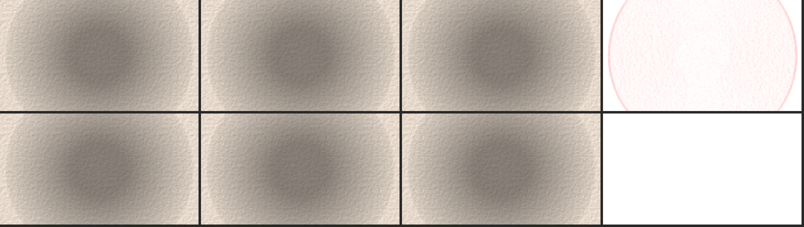

Todas: [1080p_blocos_pan_antes_depois](B16c/1080p_blocos_pan_antes_depois.png) · [1080p_blocos_zoom400_antes_depois](B16c/1080p_blocos_zoom400_antes_depois.png) · [1080p_branco_pan_antes_depois](B16c/1080p_branco_pan_antes_depois.png) · [1080p_branco_zoom400_antes_depois](B16c/1080p_branco_zoom400_antes_depois.png) · [1080p_papel_pan_antes_depois](B16c/1080p_papel_pan_antes_depois.png) · [1080p_papel_zoom400_antes_depois](B16c/1080p_papel_zoom400_antes_depois.png) · [4k_blocos_pan_antes_depois](B16c/4k_blocos_pan_antes_depois.png) · [4k_blocos_zoom400_antes_depois](B16c/4k_blocos_zoom400_antes_depois.png) · [4k_branco_pan_antes_depois](B16c/4k_branco_pan_antes_depois.png) · [4k_branco_zoom400_antes_depois](B16c/4k_branco_zoom400_antes_depois.png) · [4k_papel_pan_antes_depois](B16c/4k_papel_pan_antes_depois.png) · [4k_papel_zoom400_antes_depois](B16c/4k_papel_zoom400_antes_depois.png) · [notas](B16c/README.md)

## B16-cont3 — Aquarela: borda dos traços antigos estável ao trocar o tamanho

Nestas telas nada muda; só pincéis de 3–5 px mudam ~90 pontos. O ganho é velocidade ao soltar a caneta em 4K (~119 → ~3 ms).

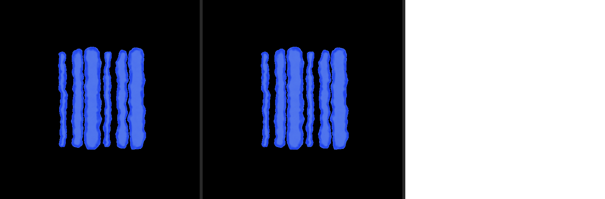

Todas: [1080p_blocos_antes_depois](B16-cont3/1080p_blocos_antes_depois.png) · [1080p_branco_antes_depois](B16-cont3/1080p_branco_antes_depois.png) · [1080p_papel_antes_depois](B16-cont3/1080p_papel_antes_depois.png) · [4k_blocos_antes_depois](B16-cont3/4k_blocos_antes_depois.png) · [4k_branco_antes_depois](B16-cont3/4k_branco_antes_depois.png) · [4k_papel_antes_depois](B16-cont3/4k_papel_antes_depois.png) · [notas](B16-cont3/README.md)

## B25a — Pincel de ponta reta girado: mesmo resultado com qualquer nº de núcleos

Nestas telas nada muda; o canto cortado só aparecia em casos raros. Agora o mesmo traço dá sempre a mesma imagem.

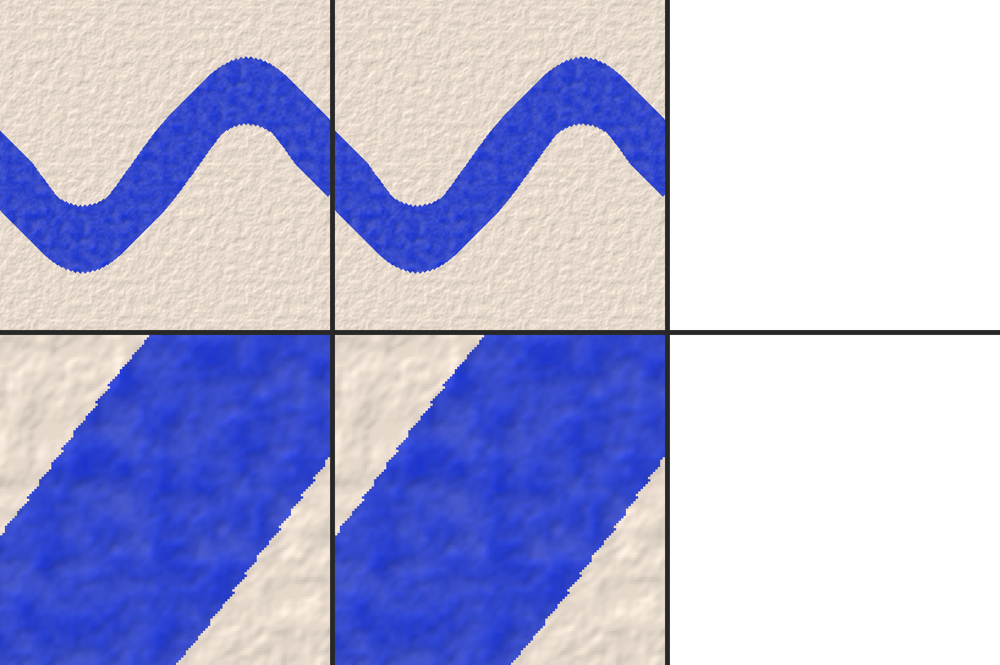

Todas: [1080p_blocos_antes_depois](B25a/1080p_blocos_antes_depois.png) · [1080p_branco_antes_depois](B25a/1080p_branco_antes_depois.png) · [1080p_papel_antes_depois](B25a/1080p_papel_antes_depois.png) · [4k_blocos_antes_depois](B25a/4k_blocos_antes_depois.png) · [4k_branco_antes_depois](B25a/4k_branco_antes_depois.png) · [4k_papel_antes_depois](B25a/4k_papel_antes_depois.png) · [notas](B25a/README.md)

## B28.3 — Pincel grande com Color mixing mais leve

Hard Round e Sketch Pencil com Color mixing, tamanho 200. O pincel grande agora «prova» a cor da tela olhando um ponto em cada quatro (a média é a mesma à vista). Diferença máxima: 1 nível de 255, em poucos pontos; no papel, nenhuma. Da esquerda: antes · depois · o que mudou (vermelho).

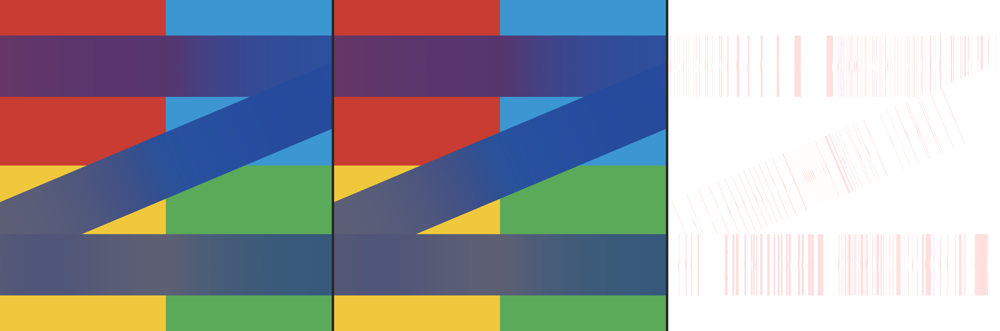

Todas: 3 fundos (branco, blocos, papel) × 1080p/4K × Hard Round/Sketch Pencil, em [B28.3/](B28.3/).

## B36 — Pincel Oil Wash

Óleo diluído (Dilution 0,6, pasta Oil/Flat) na tela inclinada, 15 s, ao lado do Filbert. O Oil Wash escorre mais (branco e papel: 77 × 63 px em 1080p, 143 × 126 em 4K); sobre os blocos de cor os dois descem igual.

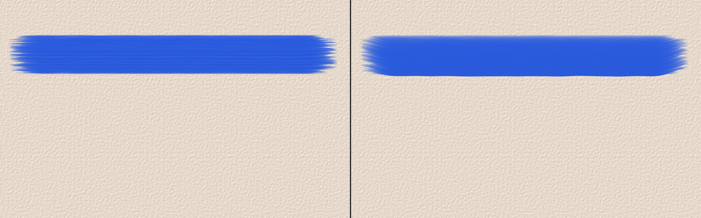

Todas: 3 fundos × 1080p/4K em [B36/](B36/).

## As 10 decisões do dono (§0 do prompt da missão)

| # | Decisão | Bloco | Prancha |
|---|---|---|---|
| 1 | Água do Wet que parou dorme (fotos 1, 4, 10 s) | B13 | ainda não feita (B13.3/B13.4 abertos) |
| 2 | Luz simples do Óleo Real só com o pincel na tela | B14 | [B14b](#b14b--óleo-real-luz-simples-enquanto-o-pincel-está-na-tela) |
| 3 | Guardar a tinta com mais precisão | B29 | ainda não feita (aberto) |
| 4 | Arrumar os controles do Wet | B35 | só controles; o que muda na tela (reset/rótulos) ainda aberto |
| 5 | Pincel Oil Wash | B36 | [B36](#b36--pincel-oil-wash) |
| 6 | Aparência acompanha o tamanho da tela | B34 | ainda não feita (aberto) |
| 7a | Mistura de cores do Wet (vermelho + azul) | B32 | ainda não feita (aberto) |
| 7b | Papel sem repetição a 256 px | B33 | [B33](#b33--papel-sem-repetição-a-cada-256-px) |
| 8 | Ritmo fixo a 60 e 144 Hz | B22 | [B22.2](#b222--spray-parado-igual-a-30-60-e-144-quadross) (spray); secagem B22.1 aberta |
| 9 | A placa mostra a prévia, o processador dá o resultado | B20 | sem mudança visível ainda (B20.8 aberto) |
| 10 | Pincel de mistura grande em meia definição | B28 | [B28.3](#b283--pincel-grande-com-color-mixing-mais-leve) (a amostra do Color mixing); B28.1/2/4/5 abertos |
| — | Janela fora de foco a 10 q/s | B23 | não muda a imagem |
